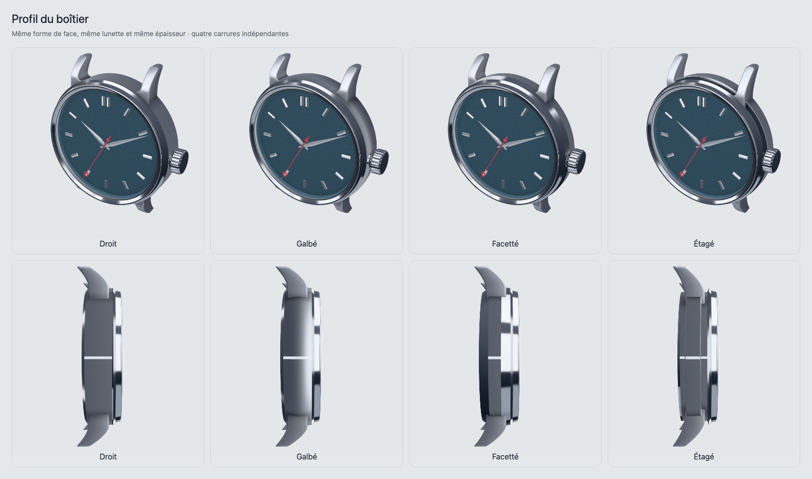

# Profils du boîtier

La ligne « Profil du boîtier », juste après la forme, propose Droit, Galbé, Facetté et Étagé. Les aperçus montrent la carrure de côté. Le profil est indépendant de l’ouverture du cadran, de la lunette et de l’épaisseur choisie.

Galbé conserve la géométrie existante et reste le profil implicite des anciens liens. Le nouveau champ de partage utilise le jeton `ah` sans modifier les identifiants ni les valeurs par défaut historiques de la version 1.

Les nouveaux profils partagent leur section avec le calcul des attaches. Les racines des cornes et des protège-couronnes restent enfouies dans la carrure ; le tube de couronne suit la normale du flanc. Les points de raccordement au fond et à la lunette restent fixes.

Les captures sont reproductibles avec `node scripts/case-profile-review.mjs` (serveur Vite local requis). Le script compare cinq formes de face, les quatre profils et les protège-couronnes sur le boîtier carré, et échoue en cas d’erreur JavaScript.
