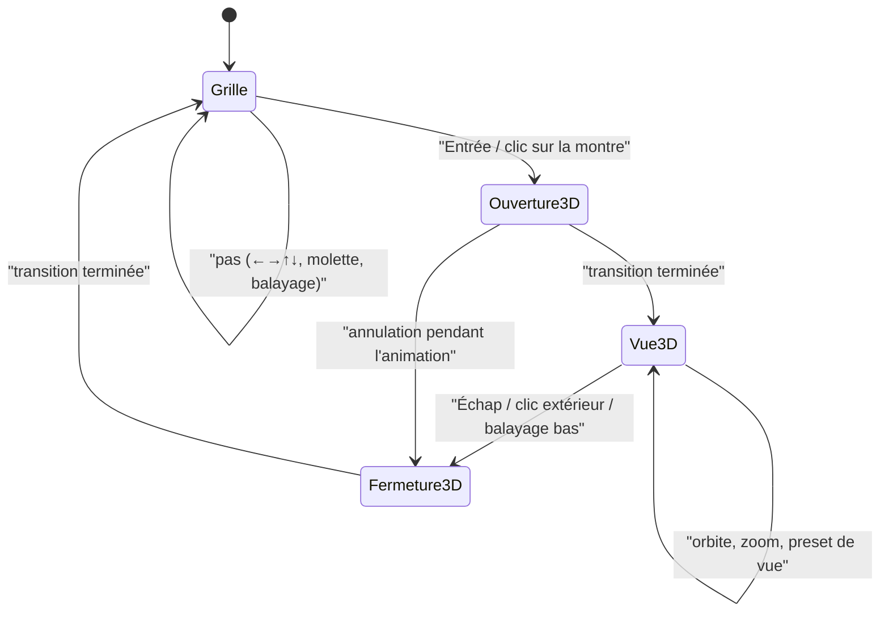
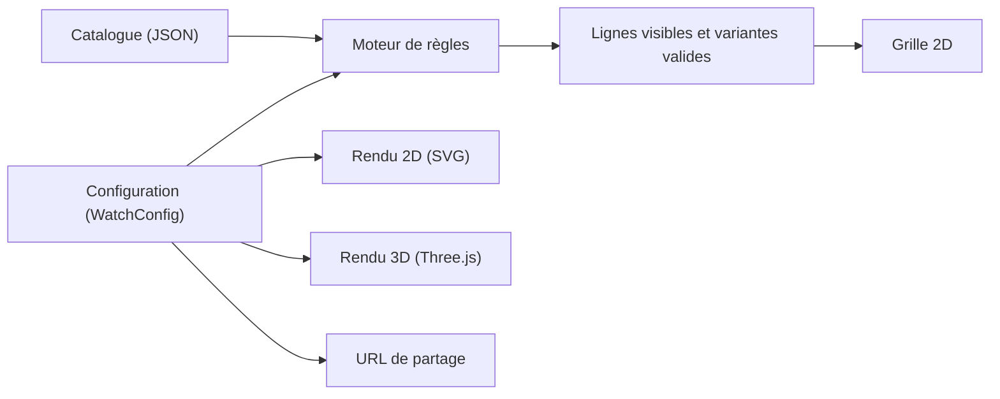
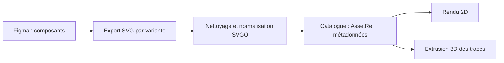

# Épure — Configurateur de montre : spécification produit et technique

> Prototype web / mobile · navigation en croix · rendu 2D puis vue 3D
> Version **0.2** — 22 novembre 2026 — document de travail, à faire évoluer avec le prototype.
> 0.2 : rendu 3D partout dans le produit final (le SVG n'est qu'un prototype), chargement guidé par la visibilité, écran de chargement accepté, taille = diamètre du boîtier, direction artistique. Détail dans `plan-action.md`.

---

## Table des matières

1. [Vision et périmètre](#1-vision-et-périmètre)
2. [Principe : la navigation en croix](#2-principe--la-navigation-en-croix)
3. [Vue 3D plein écran](#3-vue-3d-plein-écran)
4. [Modèle de données](#4-modèle-de-données)
5. [Catalogue des paramètres](#5-catalogue-des-paramètres)
6. [Styles prédéfinis](#6-styles-prédéfinis)
7. [Mouvements et compatibilité](#7-mouvements-et-compatibilité)
8. [Géométrie, unités, mises en page](#8-géométrie-unités-mises-en-page)
9. [Architecture technique](#9-architecture-technique)
10. [Feuille de route et critères d'acceptation](#10-feuille-de-route-et-critères-dacceptation)
11. [Décisions ouvertes](#11-décisions-ouvertes)
12. [Annexes](#12-annexes)

**Légende des priorités** utilisée dans tout le document :

| Code | Sens |
|---|---|
| **P0** | Existe déjà dans le fichier Figma, ou nécessaire au premier prototype |
| **P1** | Version 1 : ajoute de la profondeur sans changer l'architecture |
| **P2** | Version 2 : demande de nouveaux modèles de rendu ou des règles de compatibilité |
| **P3** | Piste d'exploration, à évaluer plus tard |

---

## 1. Vision et périmètre

### 1.1 Objectif

Permettre à n'importe qui de **dessiner sa montre** en explorant ses paramètres (boîtier, cadran, aiguilles, complications, bracelet…) par une navigation spatiale unique, sans menus ni formulaires, puis de la voir en **3D** avec un rendu crédible.

Le projet est d'abord **un exercice de product design** : la qualité de l'interaction prime sur l'exhaustivité technique. La compatibilité réelle avec des mouvements (Seiko NH35/NH38, etc.) est prévue plus tard, mais le modèle de données doit la rendre possible dès maintenant.

### 1.2 Principes de conception

1. **Chaque ligne ne contient que ce qu'elle supporte.** Une cellule montre la pièce concernée et rien d'autre (voir §2.4).
2. **Pas de libellé sur les variantes.** Le visuel doit suffire à identifier une variante. Seuls le **nom de chaque ligne** et, dessous, le **nom de la variante choisie** sont affichés, fixes en début de ligne (décision du 22 novembre) ; les cellules elles-mêmes restent sans texte ; les noms de variantes existent pour l'accessibilité et les infobulles optionnelles (voir §2.10).
3. **Le centre est toujours la configuration courante.** On ne « valide » jamais : tout choix s'applique immédiatement.
4. **Une seule gestuelle**, identique au clavier, à la molette, au tactile et à la souris.
5. **Ce qui n'est pas pertinent n'apparaît pas.** Une ligne dont les prérequis ne sont pas remplis disparaît de la grille au lieu d'être grisée (voir §4.5).
6. **Ce qu'on ne voit pas n'existe pas.** On ne charge que ce qui est visible à l'écran, plus les variantes suivantes de la ligne active ; ce qui sort du champ est libéré. Un écran de chargement au lancement est accepté.

### 1.2 bis Direction artistique

**Élégant, moderne, flottant.** Animations **douces et rapides** : durées courtes, longues décélérations, jamais d'à-coup. Les pièces flottent au-dessus du fond avec une ombre douce plutôt que d'être posées dans des disques. Traduction détaillée, à valider sur maquette : `plan-action.md` §1.5.

### 1.3 Hors périmètre (v1)

- Commande, paiement, fabrication.
- Comptes utilisateurs et galerie publique (seulement le partage par lien).
- Éditeur libre de formes (dessin vectoriel par l'utilisateur).

### 1.4 Deux modes de fonctionnement

| Mode | Règle | Usage |
|---|---|---|
| **Libre** (défaut) | Toutes les combinaisons sont autorisées, y compris celles qui seraient irréalisables mécaniquement | Exploration, exercice de style |
| **Réaliste** (P2) | Les contraintes du mouvement choisi s'appliquent : lignes masquées ou variantes retirées | Préparation d'une vraie montre modifiée |

Le moteur de règles (§4.5) est le même ; seul le jeu de règles actives change.

---

## 2. Principe : la navigation en croix

### 2.1 Modèle spatial

```
              colonne -3   -2    -1    0     +1    +2    +3
ligne  -2  (   ·     ·     ·    ◯     ·     ·     ·  )   Boîtier
ligne  -1  (   ◯     ◯     ◯    ◯     ·     ·     ·  )   Taille
ligne   0  (   ·     ◯     ◯   [◼]    ◯     ◯     ◯  )   Aiguilles   ← ligne active
ligne  +1  (   ·     ·     ◯    ◯     ◯     ·     ·  )   Cadran
ligne  +2  (   ·     ·     ·    ◯     ·     ·     ·  )   Cristal

[◼] = la montre complète (configuration courante)
◯   = une variante de la ligne
·   = pas de variante à cette position (fin de liste)
```

- **Une ligne = un paramètre** (boîtier, cadran, aiguilles, etc.).
- **Une colonne dans une ligne = une variante** de ce paramètre.
- **La colonne centrale** contient la variante actuellement choisie pour chaque ligne.
- **La ligne centrale** est la ligne active : c'est la seule où l'on change de variante.
- La montre complète apparaît **au centre de la ligne active**.

Chaque ligne conserve sa propre sélection. Quitter la ligne « Aiguilles » puis y revenir recentre la variante choisie précédemment, comme un carrousel indépendant par ligne.

### 2.2 Grille de référence (reprise du fichier Figma)

Valeurs issues de la maquette `Desktop - 1` et de ses variantes :

| Jeton | Valeur | Remarque |
|---|---|---|
| `canvas.width` / `canvas.height` | 1440 × 1024 px | Bureau de référence |
| `cell.size` | 160 px | Diamètre d'une cellule circulaire |
| `cell.pitch` | 216 px | Distance centre à centre (écart de 56 px entre cellules) |
| `grid.visibleCols` | 7 | Colonnes visibles, la 4ᵉ est la centrale |
| `grid.visibleRows` | 5 | Lignes visibles, la 3ᵉ est l'active |
| `grid.center` | (720, 512) | Centre de la cellule centrale |
| `cell.background` | `#D9D9D9` | Fond neutre d'une cellule |
| `canvas.background` | `#E5E5E3` | Fond de la grille |
| `scale.pxPerMm` | 4 | Un cadran de 40 mm = 160 px |

Les colonnes extrêmes sont **partiellement rognées** par le cadre (x = −8 et 1288) : c'est voulu, cela suggère que la ligne continue.

### 2.3 Anatomie d'une cellule

```
┌──────────────────────┐
│  cercle Ø 160        │  ← masque circulaire, overflow: hidden
│   ┌────────────┐     │
│   │ aperçu     │     │  ← rendu 2D de la variante (voir §2.4)
│   └────────────┘     │
│  [état] repos | survol | focus | sélectionné
└──────────────────────┘
```

États visuels : `idle`, `hover`, `focus` (anneau net, jamais supprimé), `selected` (la cellule centrale de sa ligne), `disabled` (jamais affiché, voir §4.5), `loading` (squelette circulaire).

### 2.4 Règles de contenu d'une cellule

| Règle | Détail |
|---|---|
| **R1** | Une cellule ne montre **que la pièce de sa ligne** : des aiguilles seules, un cadran seul, un boîtier seul. |
| **R2** | Les pièces **transparentes ou qui ne se voient pas seules** (cristal, aiguilles, bracelet) sont rendues sur un **fond neutre de contexte** (`previewContext`, voir tableau). |
| **R3** | Le **point de vue est toujours le même** dans une ligne : face avant, orthographique, centré sur le pivot de l'aiguille ou sur le centre du cadran. |
| **R4** | La **taille relative** est conservée quand elle fait partie du sens (la ligne Taille montre des disques proportionnels, mise à l'échelle commune). |
| **R5** | La variante « **aucun** » d'une option facultative est représentée **visuellement** (emplacement vide en pointillés), jamais par du texte. |
| **R6** | Le rendu est **identique** à celui de la montre assemblée, pour qu'il n'y ait pas de surprise au moment de la sélection. |

**Contextes d'aperçu** (`previewContext`) :

| Contexte | Contenu du fond | Utilisé par |
|---|---|---|
| `none` | Rien (la pièce se suffit) | Cadran, boîtier, bracelet |
| `dark-disc` | Disque sombre `#1B1F27` de 140 px | Aiguilles, trotteuse, lume |
| `dial-sample` | Cadran neutre sombre derrière la pièce | Cristal, lunette (insert), index |
| `case-sample` | Boîtier neutre autour de la pièce | Cadran (aperçu optionnel avec la lunette), couronne |
| `wrist` (P2) | Poignet stylisé | Bracelet, taille globale |

### 2.5 Bout de liste : bord ou boucle ?

Une ligne a un nombre fini de variantes (de 1 à 12 aujourd'hui). Deux comportements possibles :

| Option | Effet | Avantage | Inconvénient |
|---|---|---|---|
| **Bord** (recommandée) | La sélection s'arrête à la dernière variante, les cellules au-delà n'existent pas | Honnête sur le nombre de variantes, pas de répétition | Les lignes courtes paraissent « vides » |
| **Boucle** | La liste se répète indéfiniment | Pas de fin | Avec 3 variantes, on voit 7 cellules qui se répètent : confus |

**Règle proposée :** bord par défaut. Boucle seulement pour les lignes cycliques par nature (ex. les 12 positions d'un cadran, la teinte). À trancher après test (§11).

Sur un bord, un **effet de résistance** (léger rebond) confirme que le geste a été compris.

### 2.6 Hiérarchie visuelle

La distance au centre (en cellules) module l'échelle et l'opacité :

| Distance (en cellules) | Échelle | Opacité |
|---|---|---|
| 0 (centre) | 1,00 | 1,00 |
| 1 | 0,92 | 0,90 |
| 2 | 0,84 | 0,70 |
| 3 | 0,76 | 0,45 |
| ≥ 4 | 0,70 | 0,25 |

La distance est calculée sur la **grille** (`max(|Δcol|, |Δligne|)`), de façon à ce que les lignes inactives s'estompent aussi. Les valeurs sont des points de départ à régler à l'œil.

### 2.7 Entrées

#### Clavier

| Touche | Action |
|---|---|
| `←` `→` | Variante précédente / suivante dans la ligne active |
| `↑` `↓` | Ligne précédente / suivante |
| `Début` `Fin` | Première / dernière variante de la ligne |
| `Page ↑` `Page ↓` | Saut de 5 lignes |
| `Entrée` ou `Espace` | Sur la montre centrale : ouvre la vue 3D (§3). Sur une autre cellule : la recentre |
| `Échap` | Ferme la vue 3D |
| `R` (P1) | Variante aléatoire dans la ligne ; `Maj+R` : tout aléatoire |
| `Z` / `Maj+Z` (P1) | Annuler / rétablir |
| `Tab` | Sort de la grille vers les contrôles globaux (partage, mode, langue) |

#### Molette et pavé tactile

- Défilement vertical = **changement de ligne**.
- Défilement horizontal, ou `Maj` + molette = **changement de variante**.
- **Verrouillage d'axe** : le premier mouvement significatif (> 8 px) décide de l'axe pour toute la séquence. Un pavé tactile envoie souvent un peu des deux axes ; sans verrouillage, la grille « dérive ».
- **Accumulation et seuil** : un pas = 1 cellule quand l'accumulation dépasse 40 px de défilement. Les pavés à inertie génèrent des rafales d'événements : ignorer les événements pendant l'animation de pas en cours (≈ 180 ms), mais conserver le surplus.
- Prise en charge du défilement par paliers des souris à molette classique (`deltaMode` = ligne).

#### Tactile (mobile)

| Geste | Action |
|---|---|
| Balayage vertical | Change de ligne |
| Balayage horizontal | Change de variante |
| Appui sur une cellule voisine | La recentre (déplacement d'une ou deux cellules) |
| Appui sur la montre centrale | Ouvre la vue 3D |
| Appui long sur une cellule (P1) | Infobulle avec le nom (voir §2.10) |
| Pincement | Réservé à la vue 3D |

Verrouillage d'axe dès 10 px, seuil de validation à 30 % de la distance d'une cellule ou 0,3 px/ms de vitesse, **inertie** limitée à 3 cellules par geste.

#### Souris

Clic sur une cellule = la recentrer. Glisser (≥ 6 px) = faire défiler comme au tactile. Le survol met en valeur la cellule sans la déplacer.

#### Manette (P3)

Croix directionnelle pour la navigation, bouton A pour la 3D, B pour fermer. Utile pour une démonstration sur grand écran.

### 2.8 Animation

| Élément | Durée | Courbe | Remarque |
|---|---|---|---|
| Pas de variante (une cellule) | 180 ms | `cubic-bezier(0.2, 0, 0, 1)` | Translation + échelle + opacité en un seul mouvement |
| Changement de ligne | 220 ms | idem | La ligne active glisse vers le centre |
| Effet de bord (rebond) | 120 ms aller, 160 ms retour | `ease-out` puis ressort | Amplitude 8 px |
| Mise à jour de la montre centrale | 120 ms | fondu enchaîné | Évite le « clignotement » lors d'un changement de pièce |
| Ouverture de la vue 3D | 450 ms | `cubic-bezier(0.3, 0, 0, 1)` | Voir §3.2 |

**Mouvement réduit** (`prefers-reduced-motion`) : les déplacements deviennent des fondus de 80 ms, plus d'effet de bord ni de rotation automatique.

Pour tenir 60 images par seconde : animer uniquement `transform` et `opacity`, promouvoir la grille en couche composée (`will-change: transform` posé juste avant l'animation, retiré après), ne jamais animer `width`, `height` ou `filter`.

### 2.9 Adaptation mobile

| Contrainte | Choix |
|---|---|
| Écran étroit (portrait) | Cellule 104–120 px, 3 colonnes et 5 lignes visibles ; la montre centrale occupe ≈ 45 % de la largeur |
| Zones de sécurité | Marges `env(safe-area-inset-*)` ; aucune cellule sous l'encoche |
| Cibles tactiles | Une cellule fait au moins 96 px, très au-dessus des 44 px recommandés |
| Conflit avec les gestes système | Zone de 20 px à gauche pour le retour (iOS) : le balayage horizontal ne démarre pas dans cette zone |
| Paysage | 7 colonnes et 3 lignes visibles |
| Retour haptique (P1) | `navigator.vibrate(8)` à chaque pas où l'API existe (Android) ; pas d'équivalent sur iOS Safari |
| Hors-ligne | PWA : catalogue, miniatures et moteur 2D précachés ; la 3D se charge à la demande |

### 2.10 Absence de libellés et accessibilité

La décision est de **ne pas afficher de libellé**. Pour que cela reste utilisable :

- Le **modèle ARIA** est celui d'une grille : `role="grid"`, une ligne `role="row"` par paramètre, une cellule `role="gridcell"` par variante, avec `aria-label` complet (« Aiguilles, Épée, 3 sur 6 »).
- **Focus itinérant** (`roving tabindex`) : une seule cellule a `tabindex="0"`, les autres `-1`.
- Une **zone `aria-live="polite"`** annonce le changement après chaque pas, sans interrompre (« Cadran : huile »).
- Les noms existent donc dans le DOM et sont lus par les lecteurs d'écran, même s'ils ne sont jamais dessinés.
- **Option « libellés »** (bascule globale, P1) pour qui le souhaite : affiche le nom sous la cellule centrale uniquement.
- **Contraste** : l'anneau de focus fait 3 px et respecte 3:1 contre le fond ; la sélection ne repose jamais sur la seule couleur (échelle + position).
- Le geste n'est jamais la seule voie : tout reste faisable au clavier.
- **Daltonisme** : les lignes de couleur (teinte de cadran, bracelet) incluent un motif ou une forme secondaire en option (P2).

### 2.11 Machine à états



L'état de navigation est simple et sérialisable :

```ts
interface NavState {
  activeRow: number;                       // index dans la liste des lignes visibles
  selectionByRow: Record<RowId, number>;   // index de variante sélectionnée, par ligne
  mode: 'grid' | 'opening3d' | 'view3d' | 'closing3d';
}
```

---

## 3. Vue 3D plein écran

### 3.1 Intention

Un clic (ou `Entrée`, ou un appui) sur la **montre confectionnée** au centre l'agrandit **par-dessus la grille** et la fait passer en 3D. C'est le moment où l'utilisateur vérifie son travail : le rendu doit être soigné, mais surtout fluide.

### 3.2 Transition d'ouverture

Principe de **transition d'élément partagé** (technique FLIP) :

1. **First** : mesurer la boîte de la cellule centrale (`getBoundingClientRect`).
2. **Last** : calculer la boîte cible (carré centré de `min(80 vw, 80 vh)`).
3. **Invert / Play** : la montre 2D grandit de l'une à l'autre en 450 ms.
4. En parallèle, la **grille recule** : échelle 0,96, flou 8 px, opacité 0,35, puis `inert`. Le flou est pré-rasterisé (une image de la grille), jamais un `filter` animé sur 35 cellules.
5. Le **canvas 3D** est monté sous le rendu 2D dès le début de la transition. Quand le premier cadre est prêt, **fondu enchaîné** 2D → 3D (150 ms). La 2D sert d'affiche : jamais d'écran noir ni de saut.
6. La **caméra** commence face-avant en projection orthographique, alignée sur la vue 2D, puis passe en perspective vers une vue ¾ (azimut −25°, élévation 20°) pendant la deuxième moitié de la transition. Le basculement 2D → 3D se lit comme un seul mouvement.

Sur appareil modeste (détection : `navigator.hardwareConcurrency ≤ 4` ou images lentes mesurées), la transition devient un fondu simple.

### 3.3 Contrôles dans la vue 3D

| Entrée | Action |
|---|---|
| Glisser (souris, un doigt) | Orbite autour de la montre, avec inertie (amortissement 0,08) |
| Molette / pincement | Zoom (distance 0,6× à 3× la distance de départ) |
| Clic droit ou deux doigts glissés | Panoramique, limité pour garder la montre dans le cadre |
| Double clic / double appui | Réinitialise la vue |
| `←` `→` `↑` `↓` | Rotation par pas de 15° |
| `1` à `5` | Vues prédéfinies : face, profil gauche, dessus, dos, au poignet |
| `L` | Bascule le **mode nuit** (lume, éclairage atténué) |
| `P` | Pause / lecture des aiguilles |
| `Échap`, `Espace`, `Entrée`, clic hors du modèle, balayage vers le bas, bouton ✕ | Ferme (les touches qui ouvrent la vue la referment) |

**Limites d'orbite** : élévation de −10° à 90° (on ne passe pas sous la table), sauf pour la vue dos. Distance minimale réglée pour ne jamais traverser le boîtier.

### 3.4 Contenu visible

- La montre en **temps réel** : aiguilles animées (voir §9.5) avec la cadence du mouvement choisi (§7.2).
- Option **heure figée à 10 h 10** pour les captures.
- **Réflexions** : environnement HDRI « studio » par défaut ; options « jour », « intérieur chaud », « nuit ».
- **Mode nuit** : éclairage réduit, lume en émission avec léger halo (bloom), dans la couleur du lume choisi (§5, ligne Lume).
- **Iridescence** (cadrans nacré et huile) : réagit à l'angle de vue grâce à `iridescence` de `MeshPhysicalMaterial`. Sur mobile, l'inclinaison de l'appareil (`DeviceOrientation`, avec demande de permission sur iOS) pilote la lumière : l'effet est visible sans toucher l'écran.
- **Ombres de contact** : ombre douce du boîtier sur le support, ombre des aiguilles sur le cadran (peu coûteuse si calculée par texture d'ambiance).

### 3.5 Boutons (icônes seules, comme la grille)

| Icône | Action | Priorité |
|---|---|---|
| ✕ | Fermer | P0 |
| ☾ | Mode nuit | P1 |
| ⌖ | Réinitialiser la vue | P0 |
| ⤓ | Exporter une image (PNG 2048 px, fond transparent possible) | P1 |
| ⟲ | Rotation automatique (turntable) | P1 |
| 🔗 | Copier le lien de partage (§9.6) | P1 |
| ● | Enregistrer une courte vidéo 360° (`MediaRecorder`) | P2 |

### 3.6 Édition depuis la 3D (décision à prendre)

- **v1 : lecture seule.** Les flèches pilotent la caméra, pas la configuration.
- **v2 : navigation conservée.** Un geste (par exemple `Maj` + flèches, ou un balayage depuis le bord) change les variantes pendant que le modèle est affiché, et la montre se met à jour en direct. C'est plus riche, mais il faut un second mode d'entrée sans le brouiller avec l'orbite.

### 3.7 Retour à la grille

Transition inverse. Le **focus clavier retourne** sur la cellule centrale. Si la configuration a changé pendant la 3D (v2), les cellules des lignes concernées sont régénérées avant l'animation de retour.

### 3.8 Budgets de rendu 3D

| Métrique | Bureau | Mobile |
|---|---|---|
| Fréquence cible | 60 i/s | 60 i/s (45 minimum) |
| Triangles | ≤ 400 k | ≤ 150 k |
| Appels de rendu | ≤ 150 | ≤ 80 |
| Textures | ≤ 4096 px | ≤ 2048 px (compressées KTX2) |
| Résolution de rendu | DPR ≤ 2 | DPR ≤ 1,5, réduction dynamique |
| Mémoire GPU | ≤ 300 Mo | ≤ 150 Mo |
| Premier cadre 3D après ouverture | ≤ 600 ms | ≤ 1 s |

Qualité **adaptative** : l'échelle de résolution baisse automatiquement si les images ralentissent, puis remonte quand l'appareil est au repos.

**Repli** si WebGL est indisponible ou si le contexte est perdu : la vue agrandie reste en 2D, avec une rotation simulée entre 5 à 7 images pré-rendues (P2).

---

## 4. Modèle de données

### 4.1 Vue d'ensemble



Séparer **trois objets** :

1. **Le catalogue** (`catalog.json`) : tout ce qui existe — lignes, variantes, assets, règles. Statique, versionné.
2. **La configuration** (`WatchConfig`) : le choix courant de l'utilisateur. Petite, sérialisable, partageable.
3. **L'état de navigation** (`NavState`) : où l'on est dans la grille. Éphémère.

### 4.2 `WatchConfig` — configuration d'une montre

```jsonc
{
  "schema": 1,
  "style": "diver",                       // préréglage de départ, facultatif
  "movement": "nh35",                     // voir §7
  "case": {
    "shape": "round",                     // round | cushion | tonneau | octagon | square | rectangle | asymmetric
    "diameterMm": 40,
    "thicknessMm": 11,
    "lugToLugMm": 47,
    "lugWidthMm": 20,
    "lugs": "straight",                   // straight | curved | drilled | integrated | none
    "material": "steel",                  // steel | titanium | bronze | gold-yellow | gold-rose | ceramic | brass | carbon
    "finish": "brushed",                  // brushed | polished | mixed | pvd-black | sandblasted | patina
    "caseback": "solid"                   // solid | display | engraved
  },
  "crown": { "style": "onion", "position": "3h", "guard": false, "screwed": true },
  "bezel":  { "type": "rotating", "insert": "ceramic", "scale": "dive-60", "color": "#101418", "pip": "lume" },
  "crystal": { "type": "sapphire-domed", "coating": "ar-blue", "cyclops": false },
  "dial": {
    "material": "metal",
    "finish": "sunburst",                 // sunburst | matte | grained | guilloche | enamel | iridescent-pearl | ...
    "color": "#1E3A6B",
    "pattern": null,
    "chapterRing": "railroad",            // none | railroad | dots | ticks | five-minute
    "indices": { "style": "baton", "finish": "applied-polished", "lume": "c3-green", "numerals": null },
    "text": { "brand": "FLORIAN", "line2": "AUTOMATIC", "position": "12h" }
  },
  "hands": {
    "set": "dauphine",
    "finish": "polished",
    "lume": "c3-green",
    "second": { "style": "lollipop", "color": "#F0561D", "counterweight": true }
  },
  "complications": [
    { "type": "date", "position": "3h", "frame": true, "discColor": "white" },
    { "type": "small-seconds", "position": "6h" }
  ],
  "strap": { "type": "leather", "material": "calf-grained", "color": "#5A3A22", "stitching": "#C8B08A", "widthMm": 20, "buckle": "tang" },
  "view": { "time": "live", "lighting": "studio", "night": false }
}
```

Règles de format :

- Toutes les **longueurs en millimètres** (le rendu convertit : 4 px/mm en 2D).
- Les **identifiants** sont des chaînes `kebab-case`, jamais des index (stables d'une version à l'autre).
- Les champs inconnus sont **ignorés** (compatibilité ascendante) ; le champ `schema` permet les migrations.
- Les couleurs libres sont en hexadécimal `#RRGGBB` ; les couleurs « catalogue » ont un identifiant.

### 4.3 `RowDef` — définition d'une ligne de la grille

```ts
type RowKind =
  | 'enum'      // variantes discrètes (aiguilles, index, cristal…)
  | 'ordinal'   // série ordonnée (taille en mm)
  | 'palette'   // pastilles de couleur
  | 'toggle'    // présent / absent (option facultative)
  | 'text';     // saisie libre (gravure, signature) → cellule d'édition

interface RowDef {
  id: string;                        // 'hands', 'dial-finish', 'power-reserve'…
  group: GroupId;                    // 'case' | 'face' | 'movement' | 'strap' | 'finishing'
  kind: RowKind;
  path: string;                      // chemin dans WatchConfig, ex. 'hands.set'
  previewContext: 'none' | 'dark-disc' | 'dial-sample' | 'case-sample' | 'wrist';
  looping?: boolean;                 // défaut false
  priority: 'P0' | 'P1' | 'P2' | 'P3';
  variants: VariantDef[];
  visibleWhen?: RuleExpr;            // §4.5
  i18n: { name: string; hint?: string }; // nom pour ARIA et infobulle
}

interface VariantDef {
  id: string;                        // 'dauphine'
  value: unknown;                    // valeur écrite dans WatchConfig
  preview: AssetRef;                 // rendu de cellule
  render2d?: AssetRef;               // couches pour la montre assemblée
  render3d?: AssetRef;               // maillage ou paramètres de matériau
  requires?: RuleExpr;               // conditions de validité
  tags?: string[];                   // 'sport', 'dress', 'vintage'…
  i18n: { name: string };
}
```

### 4.4 Lignes spéciales

- **Saisie libre** (`text`) : la cellule centrale devient un champ d'édition (clavier virtuel sur mobile). Limiter à 2 lignes de 16 caractères, caractères latins, avec aperçu immédiat sur le cadran.
- **Palette** : 8 à 12 pastilles organisées par teinte. Le sélecteur libre (roue de couleur) est un mode secondaire (P2).
- **Ordinal** : les valeurs sont ordonnées ; la navigation reste identique aux autres lignes.
- **Aucun** : première variante d'une ligne facultative, rendue comme un emplacement vide.

### 4.5 Moteur de règles

Chaque règle est déclarative :

```jsonc
{
  "id": "date-needs-movement",
  "scope": "realistic",                       // 'free' | 'realistic' | 'both'
  "when":    { "complications.date": "present" },
  "require": { "movement.capabilities": { "includes": "date" } },
  "onViolation": "hide-variant"               // hide-row | hide-variant | auto-fix | warn
}
```

Types de règles :

| Type | Exemple |
|---|---|
| **requires** | La lunette tournante demande un boîtier avec une couronne vissée |
| **excludes** | Le tourbillon exclut le fond plein (il faut le voir) |
| **implies** | Un style « plongée » impose un cristal plat ou bombé, pas d'hésalite |
| **default** | Le chronographe active `crown.position = "3h"` et deux poussoirs |
| **range** | Le diamètre du cadran est borné par celui du boîtier moins 6 mm |
| **layout** | La petite seconde à 6 h exclut un guichet de date à 6 h |

Algorithme d'évaluation (idempotent, à chaque changement) :

1. Appliquer le changement demandé.
2. Appliquer les règles `implies` et `default` jusqu'à stabilité (limite de 8 passes).
3. Calculer, pour chaque ligne, la **visibilité** et l'ensemble des **variantes valides**.
4. Si la variante sélectionnée n'est plus valide, appliquer `auto-fix` (la plus proche valide) et **signaler** brièvement par un effet visuel discret.
5. Mettre à jour la grille.

Détection de cycles : si le point fixe n'est pas atteint en 8 passes, annuler le changement et journaliser une erreur de catalogue.

### 4.6 Identifiants et versions

- `schema` pour `WatchConfig` ; `catalogVersion` pour le catalogue.
- Un script de migration par version (`migrate_1_to_2`).
- Les variantes retirées du catalogue sont **remplacées par un alias** vers leur équivalent le plus proche, jamais supprimées silencieusement.

---

## 5. Catalogue des paramètres

Ce chapitre répertorie les lignes possibles de la grille. Chaque table donne des **variantes d'exemple**, le **contexte d'aperçu**, les **dépendances** et une **priorité**. Les noms de marques ne sont pas utilisés : ce sont des archétypes de conception.

**Ordre des lignes** (de haut en bas, révisé le 23 novembre) : du général au détail — la silhouette, puis la matière, puis les détails de la carrure, le cristal qui sépare le boîtier du cadran, le cadran du fond à l'impression, et enfin ce qui bouge.

| Groupe | Lignes, dans l'ordre | Logique |
|---|---|---|
| Départ | Style (préréglage, à venir) | Un point de départ cohérent avant de détailler |
| Silhouette | Forme du boîtier · Taille · Cornes | Ce qui se lit en premier, de loin |
| Matière | Matière du boîtier · Finition du boîtier | S'applique à toute la silhouette |
| Carrure | Couronne · Position de la couronne · (Lunette, à venir) | Détails montés sur le boîtier |
| Verre | Cristal | Sépare le boîtier du cadran |
| Cadran | Forme · Finition · Couleur · Piste des minutes · Index · Chiffres · Typographie | Du fond vers l'impression |
| Aiguilles | Jeu d'aiguilles · Trotteuse · Couleur de trotteuse · (Lume, à venir) | Ce qui bouge, posé sur le cadran |
| À venir | Complications · Mouvement · Fond de boîte · Bracelet | |

### 5.1 Boîtier

| Ligne | Variantes | Aperçu | Dépend de | Prio |
|---|---|---|---|---|
| **Forme** | Rond · coussin · tonneau · octogonal · carré · rectangulaire (type « Tank ») · asymétrique (couronne à 4 h) | `none` | Taille, cornes | P0 rond, P1 autres |
| **Matière** | Acier · titane · bronze · or jaune · or rose · céramique noire · laiton plaqué · carbone forgé | `none` | Finition | P1 |
| **Finition** | Brossé · poli · mixte (brossé + chanfreins polis) · noir mat (PVD/DLC) · sablé · patiné (bronze) | `none` | Matière | P1 |
| **Taille** (diamètre du **boîtier**, hors couronne, standard du marché ; le cadran en découle) | 22 · 24 · 26 · 28 · 30 · 32 · 34 · 36 · 38 · 40 · 42 · 46 mm (les 12 du fichier) ; étendre à 44, 48 | `none`, disques proportionnels | Cornes, cadran | P0 |
| **Épaisseur** | Fin (8 mm) · standard (11 mm) · épais (14 mm) | profil `none` | Mouvement, cristal | P1 |
| **Cornes** | Droites · courbes (vers le poignet) · creuses · intégrées au bracelet · soudées/pointues · aucune (boîtier sans corne) | `none` | Bracelet | P0 (2 variantes existantes) |
| **Entre-cornes** | 18 · 20 · 22 · 24 mm | `none` | Bracelet | P1 |
| **Étanchéité visible** | Aucune · couronne vissée · couronne vissée + fond vissé | `case-sample` | Couronne | P3 |

### 5.2 Lunette

| Ligne | Variantes | Aperçu | Dépend de | Prio |
|---|---|---|---|---|
| **Type** | Lisse · fine · épaisse · godronnée · cannelée · crantée · tournante unidirectionnelle · tournante bidirectionnelle · GMT 24 h | `none` | Boîtier | P1 |
| **Insert / échelle** | Graduation 60 min (plongée) · 12 h · 24 h (GMT) · tachymètre · pulsomètre · télémètre · règle à calcul · aucune | `none` | Type | P1 |
| **Matériau de l'insert** | Aluminium · céramique · saphir · acier gravé | `none` | Échelle | P1 |
| **Couleur de l'insert** | Noir · bleu · vert · rouge/bleu bicolore · marron · gris · blanc | `none` | Matériau | P1 |
| **Repère à 12 h** | Point lumineux · triangle · rond creux · aucun | `none` | Lume | P1 |
| **Sertissage** (fantaisie) | Aucun · baguettes · brillants | `none` | Matière | P3 |

### 5.3 Cristal

| Ligne | Variantes | Aperçu | Dépend de | Prio |
|---|---|---|---|---|
| **Type** | Saphir plat · saphir bombé · saphir double bombé (« boîte ») · verre minéral · acrylique (« hésalite ») | `dial-sample` | Boîtier | P0 (1 variante) |
| **Traitement** | Aucun · antireflet intérieur · antireflet double face · antireflet bleuté · antireflet violet | `dial-sample` | Type | P1 |
| **Loupe de date** | Aucune · loupe simple (×2) · loupe forte (×2,5) | `dial-sample` | Date | P1 |
| **Teinte** | Transparent · légèrement fumé · jaune d'âge (vieilli) | `dial-sample` | Type | P2 |

Variantes propres au rendu 3D : indice de réfraction (saphir 1,77 · minéral 1,52 · acrylique 1,49), épaisseur, courbure.

### 5.4 Couronne

| Ligne | Variantes | Aperçu | Dépend de | Prio |
|---|---|---|---|---|
| **Forme** | Cannelée · oignon · pointue · carrée · pompe · à protège-couronne | `case-sample` | Boîtier | P0 (2 variantes) |
| **Position** | 3 h · 4 h · 2 h (pour un modèle « pilote ») | `case-sample` | Boîtier | P1 |
| **Signature** | Gravée du logo · lisse | `case-sample` | Texte | P2 |
| **Poussoirs** | Aucun · deux poussoirs ronds · deux poussoirs de type « pompe » | `case-sample` | Chronographe | P1 |

### 5.5 Cadran

| Ligne | Variantes | Aperçu | Dépend de | Prio |
|---|---|---|---|---|
| **Matière** | Métal (laiton) · émail grand feu · nacre · pierre dure · météorite · bois · carbone · fibre (type kevlar) · paille (marqueterie) · saphir transparent · squelette | `none` | Mouvement (pour squelette) | P1 |
| **Finition de surface** | Mat · soleillé · grainé (sablé) · grené · satiné · laqué brillant · patiné (aspect vieilli) · iridescent · dégradé | `none` | Matière | P0 (3 variantes) |
| **Guillochage** | Aucun · clous de Paris · tapisserie · grain d'orge · flinqué (rayons) · vagues · damier · soleil | `none` | Finition | P2 |
| **Couleur** | Noir · blanc · argent · bleu nuit · bleu ciel · vert · bordeaux · saumon · champagne · gris ardoise · cuivre | `none` | Finition | P1 |
| **Dégradé** | Aucun · fumé (bord sombre) · radial · diagonal · bicolore | `none` | Couleur | P1 |
| **Patine** | Neuve · légèrement vieillie · fortement vieillie (« tropical ») | `none` | Couleur | P2 |
| **Piste extérieure** (« chapter ring ») | Aucune · chemin de fer · points · bâtons · graduée par 5 minutes · en retrait | `none` | Cadran | P0 |
| **Cadran étagé** | Plat · rehaut incliné (flange) · double niveau | `none` | Boîtier | P2 |

Pierres dures et matières naturelles : chaque pierre est un **jeu de textures** (carte d'albédo + normale + rugosité) tiré d'un catalogue ; la marqueterie de paille (projet de départ de l'utilisateur) est une variante à part entière, avec sa teinte dorée et son motif directionnel.

### 5.6 Index et chiffres

| Ligne | Variantes | Aperçu | Dépend de | Prio |
|---|---|---|---|---|
| **Style d'index** | Bâtons · bâtons facettés · dauphine · points · points sertis de lume · triangles · double chevron à 12 h · baguettes · gouttes · aucun | `dial-sample` | Cadran | P0 (jeu « indexes ») |
| **Finition** | Appliqués polis · appliqués brossés · imprimés · fraisés (creux) · dorés · noircis | `dial-sample` | Style | P1 |
| **Chiffres arabes** | Sans empattement fin · sans empattement gras · géométrique · art déco · serif classique · italique · mono (style « terminal ») | `dial-sample` | — | P0 |
| **Chiffres romains** | Classiques · fins · inscrits sur piste | `dial-sample` | — | P1 |
| **Jeu de chiffres** | Tous (12) · cardinaux 12-3-6-9 · 12 seul · 6 et 12 · aucun · type « explorateur » (3-6-9 + index) | `dial-sample` | Style | P0 |
| **Hauteur** | Fine · standard · haute | `dial-sample` | Style | P1 |
| **Lume** | Aucune · vert (Super-LumiNova C3) · bleu (BGW9) · ancienne (teinte crème, vieilli) | `dark-disc` | Index, aiguilles | P1 |

### 5.7 Textes et signature

| Ligne | Variantes | Aperçu | Prio |
|---|---|---|---|
| **Nom / logo** | Texte libre (≤ 16 caractères), imprimé ou appliqué | `dial-sample` | P1 |
| **Seconde ligne** | « AUTOMATIC » · « SWISS MADE » · « MADE IN FRANCE » · profondeur d'étanchéité · texte libre | `dial-sample` | P1 |
| **Position du logo** | 12 h · 6 h · sous le centre · aucun | `dial-sample` | P1 |
| **Typographie du texte** | Mêmes familles que les chiffres | `dial-sample` | P1 |
| **Gravure de fond** | Texte libre, numéro de série généré, date | `case-sample` | P2 |

### 5.8 Aiguilles

| Ligne | Variantes | Aperçu | Dépend de | Prio |
|---|---|---|---|---|
| **Jeu d'aiguilles** | Bâton · dauphine · épée · feuille · Breguet (pomme) · seringue · **cathédrale** · **alpha** · **cuiller** · **lance** · **crayon** · **flocon** · **squelette** · **Mercedes** (plongée) · **poire** · **plume** | `dark-disc` | Index, taille | P0 (6 variantes), P1 (reste) |
| **Finition** | Polies · brossées · noircies · dorées · bleuies · bicolores | `dark-disc` | Jeu | P1 |
| **Remplissage lume** | Plein · fente · contour · aucun | `dark-disc` | Lume | P1 |
| **Longueur** | Courte · standard · longue (pointe sur la piste) | `dark-disc` | Taille | P2 |

### 5.9 Trotteuse

| Ligne | Variantes | Aperçu | Prio |
|---|---|---|---|
| **Forme** | Fine · avec contrepoids · sucette (disque lume) · flèche · triangle · double lame | `dark-disc` | P0 |
| **Couleur** | Orange · rouge · bleue · jaune · assortie aux aiguilles · assortie au cadran | `dark-disc` | P0 |
| **Mouvement** | Balayage (continu) · pas de 1 s (quartz) · pas de 2 s (sécurité) · mouvement mécanique selon cadence (§7.2) | non visible (3D, animation) | P1 |
| **Absence** | Aucune (montre sans trotteuse, avec petite seconde) | `dark-disc` | P1 |

### 5.10 Complications et indications

Chaque complication est **optionnelle** (variante « aucune » en tête) et déclare sa **position**, son **style visuel** et ses **exigences de mouvement**.

| Complication | Variantes de positionnement | Variantes de style | Exigences | Prio |
|---|---|---|---|---|
| **Date** (quantième) | 3 h · 4 h 30 · 6 h · 12 h | Guichet nu · guichet cerclé · disque blanc / noir / argent · police du disque · loupe | Mouvement avec date (NH35, 4R35…) | P0 existant au mouvement |
| **Jour** | 3 h (combiné date) · 12 h · 9 h | Langue (FR, EN, ES, DE, IT, JA) · couleur du dimanche (rouge) | Mouvement jour-date (NH36) | P1 |
| **Grande date** | 12 h · centre | Deux disques côte à côte | Module spécifique | P2 |
| **Petite seconde** | 3 h · 6 h · 9 h · 12 h | Cercle plat · cercle guilloché · cercle en creux · cercle avec rail · aiguille colorée | Mouvement à petite seconde (ex. calibres à seconde à 6 h) | P1 |
| **Réserve de marche** | 12 h · 9 h · 3 h · 6 h · arc latéral | Arc gradué (de 0 à 40 h) · segments « Haut / Bas » · échelle E–F · aiguille ou disque | Mouvement avec indicateur (ex. 4R57, 6R15) | P1 |
| **Chronographe** | Bicompax (3 h + 9 h) · tricompax (3 + 6 + 9) · bicompax verticale (6 h + 12 h) | Cadran « panda » · « panda inversé » · compteurs de 30 min, 12 h, petite seconde · poussoirs ronds ou pompe · tachymètre | Mouvement chronographe (ou mécaquartz) | P1 |
| **Second fuseau (GMT)** | Aiguille 24 h centrale · lunette 24 h | Aiguille à pointe flèche · triangle · bicolore · lunette bicolore | Mouvement GMT | P1 |
| **Heures du monde** | Anneau de 24 villes · disque rotatif | Cartes, noms de villes | Mouvement dédié | P3 |
| **Phase de lune** | 6 h · 12 h · guichet arc · lune rétrograde | Disque étoilé bleu · or · argent ; hémisphère nord / sud ; visage de lune | Module de phase de lune | P2 |
| **Jour / nuit** (AM/PM) | Petit cadran, guichet | Soleil/lune · A/P · bicolore | Mouvement dédié | P2 |
| **Heures sautantes** | Guichet à 12 h · centre | Disque d'heures · minutes rétrogrades · minutes en aiguille | Mouvement dédié | P3 |
| **Calendrier annuel** | Guichets jour / date / mois | Combinés ou séparés ; langue | Module | P3 |
| **Calendrier perpétuel** | Jour / date / mois / année bissextile / phase de lune | Guichets, sous-cadrans, correcteurs | Module | P3 |
| **Alarme** | Disque d'alarme intérieur · aiguille | Aiguille d'alarme ; échelle 12 h | Mouvement dédié | P3 |
| **Compte à rebours** | Lunette · sous-cadran | Segment coloré | Mouvement quartz | P3 |
| **Tourbillon** | 6 h · 12 h | Cage visible · pont en « T » · pont flottant | Mouvement dédié | P3 |
| **Ouverture du cadran** | Balancier ouvert à 9 h (type « open heart », comme le NH38) · fenêtre au 6 h · cadran squelette · cadran saphir | Contour de la fenêtre : rond, ovale, arc | Mouvement avec balancier visible | P1 |
| **Répétition minutes** | — (invisible) | — | Module, très complexe | P3 |

**Règles de placement** (cadrans 40 mm) : voir le tableau de coordonnées au §8.3. Deux complications ne peuvent pas partager la même position ; si l'une prend un emplacement, la ligne de l'autre propose uniquement les positions libres.

### 5.11 Mouvement

La ligne « Mouvement » est celle qui, plus tard, **filtre toutes les autres** en mode réaliste (voir §7).

| Variantes | Effet visible | Prio |
|---|---|---|
| Quartz | Trotteuse au pas de 1 s ; pas de réserve de marche | P1 |
| Automatique 21 600 vib/h (famille NH35/NH36/NH38) | 6 pas/s ; réserve ≈ 41 h | P2 |
| Automatique 28 800 vib/h | 8 pas/s | P2 |
| Remontage manuel | Pas de masse oscillante au fond | P2 |
| Solaire / cinétique | Cadran à cellule, teinte sombre | P3 |
| Spring Drive | Trotteuse glissante | P3 |

### 5.12 Fond de boîte

| Ligne | Variantes | Aperçu | Prio |
|---|---|---|---|
| **Type** | Plein · plein gravé · transparent (saphir) · transparent vissé | `case-sample` (vue dos) | P2 |
| **Gravure** | Texte, numéro de série, motif | `case-sample` | P2 |
| **Masse oscillante** | Brossée · Côtes de Genève · perlée · ajourée · colorée · gravée | `case-sample` | P2 |
| **Finition des ponts** | Côtes de Genève · perlage · anglage · vis bleuies · rubis | `case-sample` | P3 |

### 5.13 Bracelet

| Ligne | Variantes | Aperçu | Prio |
|---|---|---|---|
| **Type** | Cuir (lisse, grainé, nubuck, perforé, « croco ») · NATO / ZULU · nylon tissé · caoutchouc (FKM) · acier à maillons (3 rangs, 5 rangs, Jubilee, Oyster, Milanaise, Bund) · cuir « rallye » troué · toile | `wrist` / `none` | P1 |
| **Couleur** | Noir · brun · cognac · bleu · vert · gris · rouge · bicolore (NATO) | `none` | P1 |
| **Coutures** | Ton sur ton · contraste · aucune | `none` | P1 |
| **Largeur** | 18 · 20 · 22 · 24 mm (suit l'entre-cornes) | `none` | P1 |
| **Boucle** | Ardillon · déployante · papillon · épingle · pas de boucle (NATO) | `none` | P2 |
| **Attaches** | Barrettes fixes · barrettes à dégagement rapide | — | P3 |
| **Vieillissement** | Neuf · patiné (cuir) | `none` | P3 |

### 5.14 Rendu et ambiance (non configurables mais pilotées par l'interface)

| Élément | Valeurs |
|---|---|
| **Éclairage** | Studio · lumière du jour · intérieur chaud · nuit |
| **Fond** | Neutre · dégradé · table en bois · pierre · transparent (export) |
| **Heure** | Temps réel · 10 h 10 · heure choisie |
| **Vue de départ** | Face · ¾ · poignet |

---

## 6. Styles prédéfinis

Une ligne **Style** au sommet de la grille (index 0) applique en un geste un préréglage cohérent. Sélectionner un style remplit toutes les autres lignes ; l'utilisateur retouche ensuite ce qu'il veut.

| Style | Idée | Boîtier | Cadran | Aiguilles | Complications |
|---|---|---|---|---|---|
| **Minimaliste** | Cadran nu, esprit Bauhaus | Rond 36–38, acier poli, fin | Mat blanc ou noir, sans chiffres | Bâton fines | Aucune |
| **Habillée** (dress) | Élégance discrète | Rond 36–40, or ou acier poli | Soleillé champagne, index appliqués | Dauphine | Petite seconde à 6 h |
| **Plongeuse** | Lisibilité et lume | Rond 40–42, acier brossé, couronne vissée | Noir mat, index lume | Mercedes ou épée | Date à 3 h, lunette tournante 60 min |
| **Pilote** | Cadran très lisible | Rond 40–43, couronne oignon | Noir, chiffres arabes gras | Bâton, trotteuse triangle | Date, parfois jour |
| **Terrain** (field) | Robuste, inspirée militaire | Rond 36–40, acier brossé | Noir ou vert, chiffres 24 h concentriques | Bâton lumineux | Date |
| **GMT / voyageur** | Deux fuseaux | Rond 39–41 | Noir ou bleu | Épée + aiguille 24 h flèche | Second fuseau, lunette bicolore |
| **Chronographe** | Course automobile | Rond 39–42, poussoirs | Panda ou noir | Bâton, compteurs | Tricompax, tachymètre |
| **Art déco** | Géométrie et contraste | Carré ou rectangulaire (type « Tank ») | Argent, chiffres romains | Épée bleuie | Aucune |
| **Squelette** | On voit la mécanique | Rond 40–42 | Cadran ajouré | Épée ou cathédrale | Ouverture du cadran |
| **Lune** | Poésie astronomique | Rond 38–40 | Bleu nuit étoilé | Feuille dorée | Phase de lune à 6 h, date |
| **Intégrée sport-chic** | Lunette octogonale, bracelet intégré | Octogonal, acier mixte | Grainé (motif en carreaux) | Bâton | Date à 3 h |
| **Vintage tropical** | Patine chaude | Rond 36, coussin | Brun vieilli, lume crème | Dauphine | Aucune |
| **Fantaisie iridescente** | Exploration visuelle | Rond 40 | Iridescent (nacré ou huile) | Dauphine fine | Aucune |

Un style est un **ensemble de valeurs par défaut**, pas une contrainte : l'utilisateur peut tout modifier ensuite. Garder en mémoire le style d'origine (`config.style`) pour proposer « revenir au style ».

---

## 7. Mouvements et compatibilité

### 7.1 Principe

Un **mouvement** est une fiche de capacités. Chaque ligne, chaque variante du catalogue peut déclarer ce qu'elle exige. En mode réaliste, le mouvement choisi filtre ce qui est montré.

```jsonc
{
  "id": "nh35",
  "family": "nh3x",
  "type": "automatic-handwind",
  "diameterMm": 27.4,
  "heightMm": 5.32,
  "stemPosition": "3h",
  "frequencyVph": 21600,
  "powerReserveH": 41,
  "hacking": true,
  "capabilities": ["date", "hacking", "handwind"],
  "dialFeet": "standard-28.5",
  "handBore": { "hourMm": 1.2, "minuteMm": 0.9, "secondMm": 0.25 },
  "notes": "Fiche issue de la documentation Seiko / TMI"
}
```

### 7.2 Cadence de la trotteuse

C'est la **cadence** du mouvement qui détermine l'animation de la trotteuse (et son rendu en 3D).

| Mouvement | Fréquence | Pas de trotteuse | Source |
|---|---|---|---|
| Quartz classique | — | 1 pas par seconde | usuel |
| **Seiko NH35 / NH36 / 4R35 / 4R36** | **21 600 vib/h (3 Hz)** | **6 pas par seconde** | documentation Seiko, [instructions 4R35/4R36](https://www.seikowatches.com/instructions/html/SEIKO_4R35_4R36_4R37_4R38_4R39_4R71_4R72_EN/BONDSYkqbeszsf) |
| Mouvements à 28 800 vib/h (ex. ETA 2824, Miyota 9015, Seiko 6R35) | 28 800 | 8 pas par seconde | usage courant, à vérifier avant publication |
| Mouvements à 36 000 vib/h | 36 000 | 10 pas par seconde | usage courant, à vérifier avant publication |
| Spring Drive | — | glissement continu | usage courant, à vérifier avant publication |

Formule : `pas_par_seconde = fréquence_vib_h / 3600`.

> **Précision** : le NH35 bat à **21 600 vib/h, soit 6 pas par seconde**, et non 8. Les 8 pas par seconde correspondent aux mouvements à 28 800 vib/h.

Animation : à chaque pas, la trotteuse avance de `6° / pas_par_seconde × cadence` en ≈ 40–60 ms, avec un léger **dépassement** (≈ 0,3°) suivi d'un retour, ce qui donne l'aspect mécanique caractéristique. Pour un mouvement à balayage, interpoler en continu sans à-coups.

### 7.3 Famille NH3x (point de départ de la compatibilité)

| Calibre | Fonction | Remarque |
|---|---|---|
| **NH35A** | Heures, minutes, secondes, **date à 3 h** | 24 rubis, remontage manuel, arrêt de la trotteuse (hacking), Ø 27,4 mm, hauteur 5,32 mm |
| **NH36A** | NH35A + **jour** à 3 h | Même base |
| **NH38A** | Heures, minutes, secondes, **sans date**, balancier ouvert (« open heart ») à 9 h | Même base que le NH35 ; cadran adapté (fenêtre) |

Les valeurs de dimension, fréquence et réserve du NH35A proviennent de la documentation de Seiko et de références techniques ; **les autres calibres du tableau §7.2 sont à vérifier** avant d'être présentés comme des faits.

Éléments de compatibilité à modéliser pour la préparation d'une vraie montre modifiée :

- **Diamètre du cadran** : standard 28,5 mm (certains boîtiers acceptent 30,8 mm).
- **Pieds de cadran** : positions standardisées (à documenter par mouvement).
- **Tige de remontoir** : position à 3 h (certains boîtiers autorisent d'autres positions avec un mouvement adapté).
- **Alésage des aiguilles** : diamètre de l'axe, par mouvement.
- **Hauteur disponible** entre mouvement et cristal.

### 7.4 Ligne « Mouvement » et mode réaliste

En mode réaliste :

1. Le choix du mouvement fixe les **capacités** disponibles (`date`, `power-reserve`, `chronograph`, `gmt`, …).
2. Les lignes de complications **disparaissent** si la capacité manque.
3. Les valeurs imposées (position de la couronne, cadence, nombre d'aiguilles) deviennent des **défauts verrouillés**.
4. Un indicateur discret (icône, sans texte) signale qu'une variante a été masquée à cause du mouvement, avec une infobulle accessible.

---

## 8. Géométrie, unités, mises en page

### 8.1 Unités et échelle

| Grandeur | Valeur |
|---|---|
| Unité de référence | **millimètre** |
| Échelle Figma / 2D | **4 px = 1 mm** (cadran 40 mm = 160 px ; boîtier 46 mm = 184 px) |
| Origine des coordonnées | Centre du cadran |
| Axe Y | Vers le bas en 2D (SVG) ; vers le haut en 3D |
| Angles | En degrés, sens horaire à partir de 12 h |

### 8.2 Aiguilles : convention de rotation

Reprise de la convention du fichier Figma :

- Chaque aiguille est un **cadre carré de 160 × 160 px** (= 40 mm), dessinée **pointe vers 12 h**, avec le **pivot au centre exact** du cadre.
- On fait tourner **le cadre entier** autour de son centre : l'aiguille tourne alors naturellement.
- Cadres séparés par aiguille : `Heure`, `Minute`, `Trotteuse` (avec contrepoids) et `Axe` (capuchon central), empilés dans cet ordre.
- Longueurs de référence (px à 4 px/mm) : heure ≈ 50 (12,5 mm), minute ≈ 74 (18,5 mm), trotteuse ≈ 78 (19,5 mm), avec queue de ≈ 22 (5,5 mm).

Formules (angle en degrés, `h` en 0–12, `m`, `s` avec fractions) :

```
angle_heure   = 30 × (h % 12) + 0,5 × m
angle_minute  = 6 × m + 0,1 × s
angle_seconde = 6 × s                 // balayage
              = 6 × floor(s × pps) / pps   // à pas (pps = pas par seconde)
```

L'aiguille des heures **avance avec les minutes** : elle ne saute jamais d'une heure à l'autre.

Ordre de superposition en 2D (de bas en haut) : cadran → chapter ring → index → texte → aiguilles des heures → minutes → trotteuse → capuchon → cristal.

### 8.3 Positions des sous-cadrans (point de départ, cadran Ø 40 mm)

Coordonnées **normalisées par le rayon** `R = 20 mm`, origine au centre du cadran, `y` vers le bas.

| Élément | Centre (x, y) | Taille (rayon ou largeur × hauteur) |
|---|---|---|
| Petite seconde à 6 h | (0, +0,50) | rayon 0,28 |
| Petite seconde à 9 h | (−0,50, 0) | rayon 0,28 |
| Petite seconde à 3 h | (+0,50, 0) | rayon 0,28 |
| Petite seconde à 12 h | (0, −0,50) | rayon 0,28 |
| Chronographe bicompax | (−0,50, 0) et (+0,50, 0) | rayon 0,28 |
| Chronographe tricompax | (−0,50, 0), (+0,50, 0), (0, +0,50) | rayon 0,26 |
| Date à 3 h | (+0,72, 0) | 0,22 × 0,16 |
| Date à 4 h 30 | (+0,58, +0,58) | 0,22 × 0,16 |
| Date à 6 h | (0, +0,72) | 0,22 × 0,16 |
| Réserve de marche à 9 h | (−0,50, 0) | arc de 90°, rayon 0,32 |
| Phase de lune à 6 h | (0, +0,48) | demi-lune, 0,36 × 0,22 |
| Ouverture (balancier à 9 h) | (−0,55, 0) | rayon 0,24 |

Ces valeurs sont des **points de départ** : elles servent à produire un premier rendu cohérent, à ajuster par comparaison avec des références réelles. Elles sont exprimées en proportion du rayon pour pouvoir s'appliquer à toutes les tailles de cadran.

### 8.4 Tailles

| Diamètre de boîtier | Pixels (4 px/mm) | Remarque |
|---|---|---|
| 22 – 28 mm | 88 – 112 | Montres de petite taille |
| 30 – 36 mm | 120 – 144 | Habillées, vintage |
| 38 – 42 mm | 152 – 168 | Usage courant |
| 44 – 46 mm | 176 – 182 | Grandes montres (la variante 46 mm du fichier mesure 182 px) |

La **taille affichée est celle du boîtier** (décision 0.2). Le cadran est plus petit de deux largeurs de lunette : ≈ 3 mm de chaque côté dans la maquette (boîtier 46 mm → cadran 40 mm), à moduler selon le type de lunette.

### 8.5 Tailles de cellule : mise à l'échelle

Dans la grille, tous les aperçus sont rendus **à une échelle commune** par ligne : l'aperçu d'un boîtier de 46 mm ne doit pas déborder de la cellule de 160 px ; on applique un coefficient `0,88` (soit 160 / 182) à toute la ligne Taille pour conserver les proportions relatives.

---

## 9. Architecture technique

### 9.1 Choix de pile (recommandation)

| Couche | Choix | Raisons |
|---|---|---|
| Langage | **TypeScript** (strict) | Schémas et règles sûrs |
| Interface | **Vue 3** ou **Svelte** | Réactivité fine, pas de rendu virtuel coûteux ; le code du moteur reste indépendant |
| Build | **Vite** | Démarrage rapide, import de ressources |
| État | Pinia (Vue) ou un store léger indépendant du framework | `WatchConfig` et `NavState` séparés |
| 2D | **SVG** (couches composées) | Net à toute taille, exportable, animable |
| 3D | **Three.js** (matériaux physiques) | Écosystème, iridescence, glTF, KTX2 |
| Animation | Web Animations / CSS pour la grille, `requestAnimationFrame` pour la 3D | Fluidité |
| Mobile | **PWA** d'abord ; Capacitor seulement si l'accès aux capteurs ou aux boutiques l'exige | Une seule base de code |
| Tests | Vitest (unité), Playwright (parcours), tests visuels de captures | Voir §9.9 |

Le **cœur** (catalogue, moteur de règles, état, sérialisation) est écrit sans dépendance au framework d'interface : il est testable seul et réutilisable en mobile natif.

### 9.2 Modules

```
src/
  core/
    catalog/        # types, chargement et validation du catalogue (zod)
    rules/          # moteur de règles (§4.5)
    config/         # WatchConfig, migrations, (dé)sérialisation URL
    nav/            # NavState, calcul de visibilité des lignes
  render2d/
    layers/         # composition SVG : cadran, index, aiguilles, boîtier…
    thumbnails/     # génération et cache des aperçus de cellule
  render3d/
    scene/          # caméra, éclairage, environnement
    parts/          # boîtier, lunette, cristal, cadran, aiguilles, bracelet
    materials/      # métaux, céramique, verre, iridescence, lume
  ui/
    grid/           # grille, cellules, gestes, animations
    view3d/         # transition et contrôles
    a11y/           # annonces, focus, raccourcis
  assets/           # SVG exportés de Figma, textures, HDRI
```

### 9.3 Rendu 2D et aperçus de cellule

> **Décision 0.2** : ce rendu SVG est celui du **prototype** de navigation. Dans le produit final, les cellules sont des **instantanés 3D** (pièce rendue une fois dans le contexte WebGL partagé, puis gardée comme image) et la montre centrale est rendue en 3D en direct. Le SVG reste la source des formes (aiguilles, index, impression du cadran). Voir `plan-action.md` §1.

- Chaque **pièce** est un groupe SVG paramétrable. La montre assemblée est une pile de groupes (ordre au §8.2).
- Les **aperçus** de cellule sont produits par le même code de rendu, avec le contexte (`previewContext`) approprié : une seule source de vérité, pas de doublons visuels.
- **Pré-rendu** : au chargement, générer des miniatures en `ImageBitmap` ou en SVG sérialisé, mises en cache (IndexedDB) avec la version du catalogue en clé.
- **Virtualisation** : ne rendre que les cellules visibles plus une marge d'une cellule autour (≈ 7 × 5 + marge = 9 × 7 = 63). Les autres sont des squelettes légers.
- **Priorité de chargement** : la ligne active d'abord, puis les lignes adjacentes, puis le reste en temps libre (`requestIdleCallback`).
- **Budgets** : une miniature ≤ 20 ko ; première grille affichée en moins de 1 s sur un téléphone moyen.

### 9.4 Rendu 3D

#### Géométrie

- **Boîtier** : généré de façon **paramétrique** (profil par révolution pour les formes rondes, extrusion de contour pour les autres), avec chanfreins. Cornes en pièces séparées positionnées selon l'entre-cornes.
- **Aiguilles** : extrusion à partir des **chemins SVG** exportés de Figma (une source unique pour la 2D et la 3D). Épaisseur : 0,25 mm (heure, minute), 0,15 mm (trotteuse).
- **Index** : extrusion légère (0,3–0,5 mm) pour les index appliqués ; simple texture pour les index imprimés.
- **Bracelet** : modèle simplifié (courbe de balayage) en v1, maillons en v2.
- Format d'échange : **glTF 2.0** compressé (Draco ou meshopt) pour les pièces non paramétriques.

#### Matériaux (valeurs de départ pour `MeshPhysicalMaterial`)

| Matière | Couleur | Métal | Rugosité | Autres |
|---|---|---|---|---|
| Acier brossé | `#C9CED6` | 1,0 | 0,35 | anisotropie 0,6, direction du brossage |
| Acier poli | `#E3E6EB` | 1,0 | 0,08 | — |
| Or jaune 18 k | `#E6C068` | 1,0 | 0,15 | — |
| Or rose | `#E6B5A0` | 1,0 | 0,15 | — |
| Bronze | `#B5803A` | 1,0 | 0,35 | patine par texture |
| Titane | `#8D939B` | 1,0 | 0,45 | — |
| Noir DLC / PVD | `#1A1C20` | 0,9 | 0,40 | — |
| Céramique noire | `#0E0F12` | 0,0 | 0,15 | vernis (`clearcoat` 1,0) |
| Cadran mat | selon couleur | 0,0 | 0,85 | — |
| Cadran soleillé | selon couleur | 0,6 | 0,35 | anisotropie radiale ou texture de rayons |
| Cadran iridescent | nacré / huile | 0,3 | 0,25 | `iridescence` 1,0, IOR 1,3, épaisseur 100–400 nm |
| Lume | vert / bleu / crème | 0,0 | 0,8 | `emissive` modulée par le mode nuit |

#### Cristal

- `MeshPhysicalMaterial` avec `transmission` coûte cher sur mobile : **repli** sur un matériau transparent + reflets d'environnement + liseré de bord.
- Indices : saphir 1,77, verre minéral 1,52, acrylique 1,49.
- Antireflet : teinte légère (bleu ou violet) sur les reflets, jamais sur la transmission.

#### Éclairage

- Un **HDRI** compressé (≤ 2 Mo) pour les reflets, plus une lumière principale douce et une lumière de contre-jour.
- **Pas d'ombres dynamiques** coûteuses : ombre de contact précalculée sous le boîtier, ombre propre aux aiguilles par texture.
- **Post-traitement minimal** : un léger *bloom* en mode nuit uniquement.

### 9.5 Horloge animée

```ts
class WatchClock {
  constructor(private mode: 'live' | 'fixed', private fixed = { h: 10, m: 10, s: 35 }) {}
  now(): { h: number; m: number; s: number } { /* local ou fixé */ }
  // appelé à chaque image
  angles(movement: Movement) {
    const { h, m, s } = this.now();
    const pps = movement.stepsPerSecond;               // 0 = balayage continu
    const sec = pps ? Math.floor(s * pps) / pps : s;   // quantifié à la cadence
    return {
      hour:   30 * (h % 12) + 0.5 * m,
      minute: 6 * m + 0.1 * sec,
      second: 6 * sec,
    };
  }
}
```

- Fréquence de mise à jour : une fois par image (`requestAnimationFrame`) quand la 3D est visible ; **une fois par seconde** sur la grille pour la montre centrale (les cellules des autres lignes n'animent pas leurs aiguilles).
- Pause quand l'onglet est caché (`visibilitychange`) et quand `prefers-reduced-motion` est actif.
- Dépassement de pas : amplitude 0,3°, durée 50 ms, courbe en ressort amorti.

### 9.6 Partage par lien

Une `WatchConfig` doit tenir dans une **URL courte**.

1. Normaliser (supprimer les valeurs égales aux valeurs par défaut du catalogue).
2. Transformer en tableau d'**identifiants courts** (table de correspondance versionnée) et en bits pour les booléens.
3. Encoder en **base64url**, préfixé du numéro de version : `#v1.eyJz…`
4. Longueur visée : **≤ 200 caractères** pour une configuration typique.
5. Le **fragment** (`#`) est utilisé plutôt que la requête : rien n'est envoyé au serveur.
6. Validation à l'ouverture : identifiants inconnus → valeur par défaut, avec un message discret.

Option (P2) : **image de prévisualisation** générée côté serveur pour les réseaux sociaux.

### 9.7 Pipeline des assets depuis Figma



Conventions pour que l'export soit automatisable :

- **Noms stables** : `Hands/Property 1=Aiguilles rotatives — Épée` devient `hands.sword`.
- **Variables Figma** pour les couleurs, matières et tailles (`dial.color.*`, `lume.*`) afin que la 2D et la 3D lisent les mêmes jetons.
- **Cadre de 160 × 160 px** pour toute pièce centrée sur le pivot ; le centre est toujours le point (80, 80).
- Une **vue de côté** par composant quand la 3D en a besoin (épaisseur, profil).
- Interdire les effets Figma non exportables (flou de calque, mode de fusion) dans les composants « sources » ; les décrire en paramètres de matériau à la place.

### 9.8 Performance

- **Un seul canvas WebGL** pour toute la vie de la page, créé à la première ouverture de la 3D puis conservé (évite les fuites de contexte).
- **Libération** : `dispose()` des géométries et textures quand une variante n'est plus utilisée.
- **Chargement paresseux** de Three.js (import dynamique) : la grille ne l'embarque pas.
- **Compression** : SVG minifiés, textures KTX2/Basis, géométries meshopt.
- **Mesures** : `PerformanceObserver` pour les interactions lentes (INP), compteur d'images en développement.
- **Budget de démarrage** (remplacé en 0.2) : écran de chargement en ligne (≤ 15 ko) visible en ≤ 0,3 s ; grille utilisable dès que la ligne active est prête, en ≤ 2 s sur ordinateur et ≤ 4 s sur le téléphone de référence. Valeurs de départ, à mesurer.

### 9.9 Tests

| Type | Contenu | Outil |
|---|---|---|
| Unitaires | Moteur de règles (propriétés : idempotence, absence de cycle), sérialisation URL (aller-retour), formules d'angles | Vitest |
| Composants | Grille : visibilité des cellules, bord, verrouillage d'axe | Vitest + Testing Library |
| Parcours | Clavier, molette, tactile simulé, ouverture et fermeture de la 3D | Playwright |
| Visuels | Captures des 63 cellules, de la montre centrale, de la vue 3D à angles fixes | Playwright + comparaison d'images avec tolérance |
| Accessibilité | Axe, navigation au lecteur d'écran, contraste | axe-core, tests manuels VoiceOver/TalkBack |
| Performance | Images par seconde pendant 10 s de navigation, mémoire GPU | Scripts de profilage, appareils de référence |

**Appareils de référence** : un ordinateur portable standard, un téléphone d'entrée de gamme de trois ans, un iPhone récent, une tablette.

### 9.10 Internationalisation

- Français par défaut, anglais prévu dès le départ.
- Les noms de variantes sont des **clés** (`hands.sword`), jamais des chaînes dans le code.
- Les langues de **jour** (complication) sont des variantes de contenu, pas des traductions de l'interface.
- Formats de nombre : unités métriques, virgule décimale en français.

### 9.11 Confidentialité et données

- Aucune donnée personnelle requise.
- Le lien de partage contient la configuration, rien d'autre.
- Mesure d'audience éventuelle : événements anonymes agrégés (lignes visitées, variantes choisies), sans identifiant persistant.
- La permission de `DeviceOrientation` (iOS) est demandée seulement quand l'utilisateur ouvre la 3D, avec un repli sans capteur.

---

## 10. Feuille de route et critères d'acceptation

### Jalon 0 — Grille et navigation (2D, 5 lignes)

**Contenu** : lignes Boîtier, Taille, Aiguilles, Cadran, Cristal avec les variantes du fichier Figma ; navigation clavier, molette, souris ; montre centrale en 2D ; états et animations.

**Critères** :
- La grille répond à `←↑→↓` et à la molette avec le verrouillage d'axe.
- 60 i/s sur un ordinateur portable standard pendant un défilement continu.
- Le focus est toujours visible ; toutes les cellules ont un nom accessible.
- La montre centrale reflète immédiatement le choix.

### Jalon 1 — Catalogue enrichi et règles

**Contenu** : toutes les lignes P1 du §5 (matières, finitions, index, chiffres, lume, date, petite seconde, réserve de marche) ; ligne **Style** ; moteur de règles en mode libre ; lien de partage ; annulation/rétablissement.

**Critères** :
- Ajouter une ligne ne demande **aucun code** (uniquement une entrée de catalogue).
- Un lien de partage recharge exactement la même montre.
- Les règles sont couvertes par des tests de propriétés (idempotence, absence de cycle).

### Jalon 2 — Vue 3D

**Contenu** : transition d'ouverture, orbite, zoom, vues prédéfinies, mode nuit, heure réelle, matériaux du §9.4, cristal simplifié, export d'image.

**Critères** :
- Premier cadre 3D en ≤ 600 ms après l'ouverture sur ordinateur (≤ 1 s sur mobile).
- Aucun écran noir pendant la transition.
- Retour à la grille avec le focus sur la cellule centrale.
- Qualité adaptative visible : pas d'image en dessous de 45 i/s sur le téléphone de référence.

### Jalon 3 — Mobile

**Contenu** : mise en page portrait/paysage, gestes tactiles, retour haptique, PWA hors-ligne, orientation de l'appareil pour l'iridescence.

**Critères** :
- Aucun conflit avec les gestes système testés sur iOS et Android.
- Utilisation à une main des gestes de grille.
- Installation et lancement hors connexion.

### Jalon 4 — Compatibilité et profondeur

**Contenu** : mode réaliste avec fiches de mouvements (NH35, NH36, NH38 d'abord), chronographe, GMT, phase de lune, bracelet détaillé, fond de boîte, gravure.

**Critères** :
- Choisir un mouvement masque les lignes impossibles et le signale discrètement.
- La cadence de la trotteuse correspond au mouvement choisi (§7.2).

### Jalon 5 — Exploration

Heures du monde, calendrier perpétuel, tourbillon, manette, vidéo 360°, image de prévisualisation pour le partage.

---

## 11. Décisions ouvertes

**Tranchées (0.2)** : rendu 3D partout dans le produit final ; chargement guidé par la visibilité ; écran de chargement au lancement ; taille = diamètre du boîtier ; direction artistique élégante, moderne, flottante.

| # | Question | Options | Recommandation provisoire |
|---|---|---|---|
| 1 | Fin de ligne : bord ou boucle | Bord · boucle · mixte | Bord par défaut, boucle pour les lignes cycliques |
| 2 | Contenu d'une cellule : pièce seule ou montre complète avec la variante | Pièce seule (choix actuel) · montre complète | Pièce seule ; tester la montre complète sur quelques lignes (cadran, aiguilles) |
| 3 | Nombre de lignes | ≈ 30 lignes possibles : navigation verticale longue | Regrouper (structure, face, mouvement, bracelet) et ajouter des **repères de groupe** discrets sur le bord |
| 4 | Lignes sans équivalent visuel simple (réserve de marche, étanchéité) | Pictogrammes · aperçu dans le contexte | Aperçu dans le contexte (`dial-sample`) |
| 5 | Libellés | Aucun · à la demande · sous la cellule centrale | Aucun par défaut ; option |
| 6 | Édition depuis la 3D | Lecture seule · édition en direct | Lecture seule en v1 |
| 7 | Saisie libre (gravure, logo) dans une grille de variantes | Cellule d'édition · panneau dédié | Cellule d'édition |
| 8 | Mode réaliste dès la v1 ? | Oui · non | Non ; modèle de données prêt dès le départ |
| 9 | Lignes conditionnelles : masquer ou signaler | Masquer · griser | Masquer, avec indice discret |
| 10 | Marqueterie de paille et matières naturelles : textures photo ou procédurales | Photographie · procédural | Photographie préparée à la main (une texture par matière) |

---

## 12. Annexes

### A. État actuel du fichier Figma (au 22 novembre 2026)

| Composant | Contenu | Remarque |
|---|---|---|
| `Hands` (ensemble) | 6 variantes : bâton, dauphine, épée, feuille, Breguet, seringue ; case « Show background » | Cadres rotatifs 160 × 160, pivot au centre |
| `Cadrans` (ensemble) | 3 variantes : nacré, huile (iridescents), un cadran noir | Fond uniquement, sans index |
| `Sizes` (ensemble) | 12 variantes : 22 à 46 mm (22, 24, 26, 28, 30, 32, 34, 36, 38, 40, 42, 46) | 4 px/mm ; la variante 46 mm mesure 182 px |
| `Cristal` | 1 composant (deux ellipses) | Pas de variante ; invisible seul |
| `Boxes` | Boîtier en acier (carrure, lunette, chanfreins, cornes, couronne, verre) | Frame, pas encore un composant |
| `Corne haut gauche`, `Corn`, `Crown` | Cornes et couronne : 2 variantes chacune | À fédérer avec le boîtier |
| `indexes`, `Index Unit`, autres ensembles d'index | Jeux d'index et de chiffres | — |
| `Chapter ring` | Piste des minutes | — |
| `Frame 3` | Montre assemblée : cadran, index, aiguilles, dégradé, chapter ring | Pile de composants |
| `Desktop - 1` | Maquette de la grille (7 colonnes × 5 lignes) | Cellules de 160 px, pas de 216 px |
| `Desktop - 2 (variantes)` | Copie remplie avec les composants existants | Test de la grille avec de vraies variantes |

Lacunes mises en évidence par le test : lignes avec **1 variante** (boîtier, cristal) ; **cristal transparent** sans fond de contexte ; **ligne Taille** étiquetée en texte, seule de son genre.

### B. Glossaire

| Terme | Définition |
|---|---|
| **Cadran** | Disque portant les index ; la face de la montre |
| **Chapter ring** (piste) | Anneau gradué en minutes ou secondes à la périphérie du cadran |
| **Index** | Repères horaires (appliqués ou imprimés) |
| **Lunette** | Anneau autour du cristal ; peut tourner (plongée, GMT) |
| **Carrure** | Corps du boîtier |
| **Cornes** | Pattes qui reçoivent le bracelet |
| **Entre-cornes** | Largeur intérieure entre les cornes, détermine la largeur de bracelet |
| **Lume** | Matière luminescente (Super-LumiNova) |
| **Hacking** | Arrêt de la trotteuse quand on tire la couronne, pour régler l'heure à la seconde |
| **Vib/h (vph, bph)** | Alternances du balancier par heure ; pas par seconde = vib/h ÷ 3600 |
| **Réserve de marche** | Autonomie d'un mouvement mécanique remonté à fond |
| **Guichet** | Ouverture dans le cadran (date, jour, lune) |
| **Sous-cadran** (compteur) | Petit cadran secondaire (petite seconde, compteur de chrono) |
| **Bicompax / tricompax** | Chronographe à deux / trois compteurs |
| **Panda** | Cadran clair avec compteurs foncés |
| **Open heart** | Fenêtre laissant voir le balancier |
| **Soleillé** (sunburst) | Finition à rayons brillants partant du centre |
| **Guillochage** | Gravure mécanique de motifs répétés sur le cadran |
| **Rehaut** (flange) | Anneau incliné autour du cadran, sous le cristal |
| **Hésalite** | Verre acrylique bombé des chronographes spatiaux |
| **FLIP** | Technique d'animation : mesurer, déplacer, inverser, jouer |
| **Roving tabindex** | Technique d'accessibilité : un seul élément du groupe est focusable à la fois |

### C. Exemple de définition de ligne (catalogue)

```jsonc
{
  "id": "hands",
  "group": "face",
  "kind": "enum",
  "path": "hands.set",
  "previewContext": "dark-disc",
  "looping": false,
  "priority": "P0",
  "i18n": { "name": "Aiguilles" },
  "variants": [
    { "id": "baton",     "value": "baton",     "preview": "assets/hands/baton.svg",     "tags": ["sport", "field"], "i18n": { "name": "Bâton" } },
    { "id": "dauphine",  "value": "dauphine",  "preview": "assets/hands/dauphine.svg",  "tags": ["dress"],          "i18n": { "name": "Dauphine" } },
    { "id": "sword",     "value": "sword",     "preview": "assets/hands/sword.svg",     "tags": ["dress", "sport"], "i18n": { "name": "Épée" } },
    { "id": "leaf",      "value": "leaf",      "preview": "assets/hands/leaf.svg",      "tags": ["vintage"],        "i18n": { "name": "Feuille" } },
    { "id": "breguet",   "value": "breguet",   "preview": "assets/hands/breguet.svg",   "tags": ["dress"],          "i18n": { "name": "Breguet" } },
    { "id": "syringe",   "value": "syringe",   "preview": "assets/hands/syringe.svg",   "tags": ["vintage", "sport"], "i18n": { "name": "Seringue" } }
  ]
}
```

### D. Sources externes citées

- Documentation Seiko, calibres 4R35/4R36… : fréquence 21 600 vib/h (6 vibrations par seconde), réserve ≈ 41 h — <https://www.seikowatches.com/instructions/html/SEIKO_4R35_4R36_4R37_4R38_4R39_4R71_4R72_EN/BONDSYkqbeszsf>
- Fiche NH35A (Caliber Corner) : diamètre 27,40 mm, hauteur 5,32 mm, 24 rubis — <https://calibercorner.com/seiko-caliber-nh35a>
- NH35 / NH36 / NH38 (variations par fonction) — <https://www.watchscanning.com/guides/seiko-nh35-movement/>

Toutes les autres valeurs numériques de ce document (matériaux, durées d'animation, coordonnées des sous-cadrans, budgets de performance) sont des **points de départ de conception**, à valider par le prototype.
