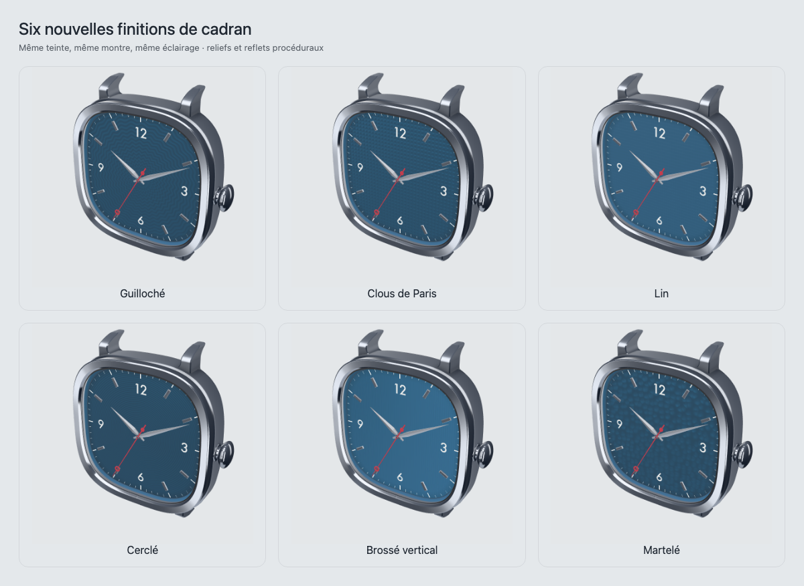

# Six nouvelles finitions de cadran

Le catalogue passe de 7 à **13 finitions**. Les sept finitions précédentes gardent leur ordre et leurs identifiants.

| Finition | Aspect |
| --- | --- |
| Guilloché | Ondulations radiales en rosace, gravure régulière et reflets métalliques. |
| Clous de Paris | Petites pyramides à quatre facettes, disposées en grille. |
| Lin | Trame croisée fine, mate et douce. |
| Cerclé | Stries concentriques de tournage. |
| Brossé vertical | Fines stries parallèles et réflexion anisotrope. |
| Martelé | Creux arrondis irréguliers, reflets plus larges et vernis léger. |

Toutes utilisent la couleur personnelle du cadran. Les cartes de normales et de rugosité sont indépendantes de cette couleur ; les textes et index restent sur leurs calques habituels. Le relief est un effet de surface : la géométrie, l’épaisseur et le passage des aiguilles restent ceux du cadran existant.

Les motifs sont définis en millimètres dans le plan XY. Leur densité tient compte du diamètre et du cadran choisi, sans étirer les motifs avec le contour. Les reflets utilisent le moteur de matériaux physiques existant, sans post-traitement ni passe de dessin supplémentaire.

Les cartes 512 × 512 partagent leurs pixels entre les aperçus de couleur, avec un cache CPU limité à douze paires (24 Mio au maximum pour ce cache). Chaque bibliothèque possède ses textures GPU et les libère normalement. Les mipmaps réduisent le scintillement des motifs fins à petite taille.

Les anciens liens fonctionnent toujours. L’identifiant v1 du guilloché (`w: 4`), déjà réservé, est réutilisé pour cette finition ; les cinq autres sont ajoutés après les identifiants existants (`w: 10` à `14`). Les couleurs libres, l’annulation et les teintes naturelles de la nacre et de l’huile conservent leur comportement.

Les contrôles portent sur les champs de relief, la direction du brossage, les normales, la réutilisation des cartes entre couleurs, les tailles 22 et 48 mm et les six formes de cadran. Les parcours navigateur vérifient les six choix, les couleurs libres, le rechargement du lien et le passage par une teinte naturelle. Les captures comparent le même bleu et le même studio, puis vérifient aussi des cadrans carré et rectangulaire avec le verre en transmission et une teinte ivoire.

Reproduire les captures : lancer Vite, puis `node scripts/dial-finishes-review.mjs` (avec `PLAYWRIGHT_CHROMIUM_EXECUTABLE_PATH` si nécessaire).

