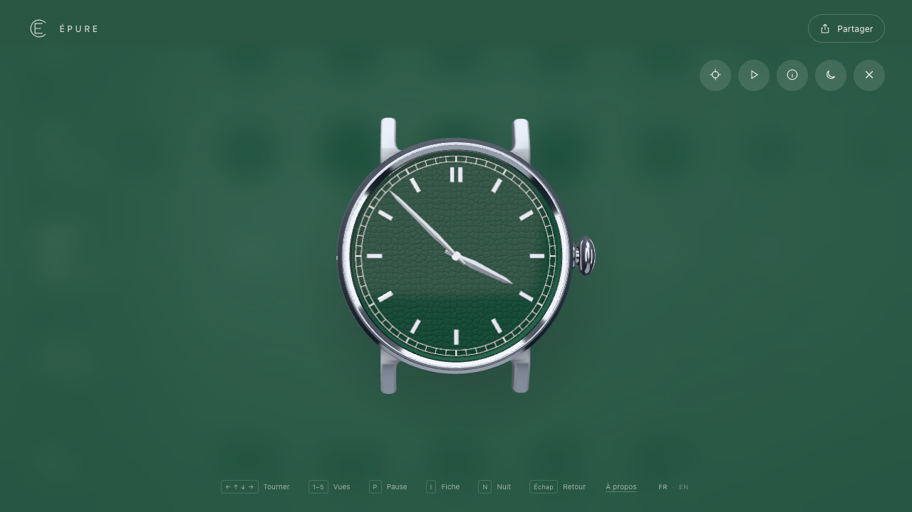
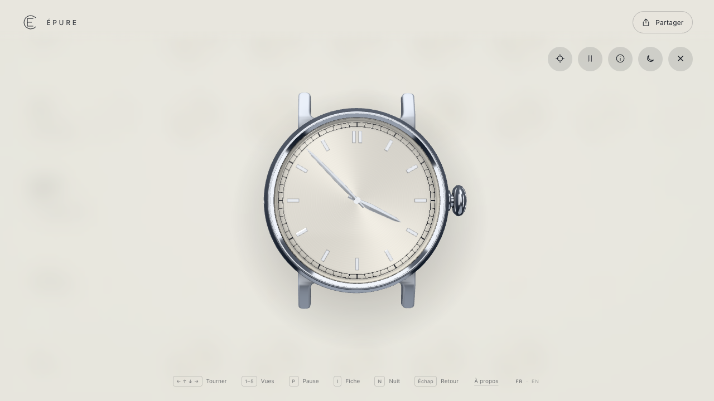
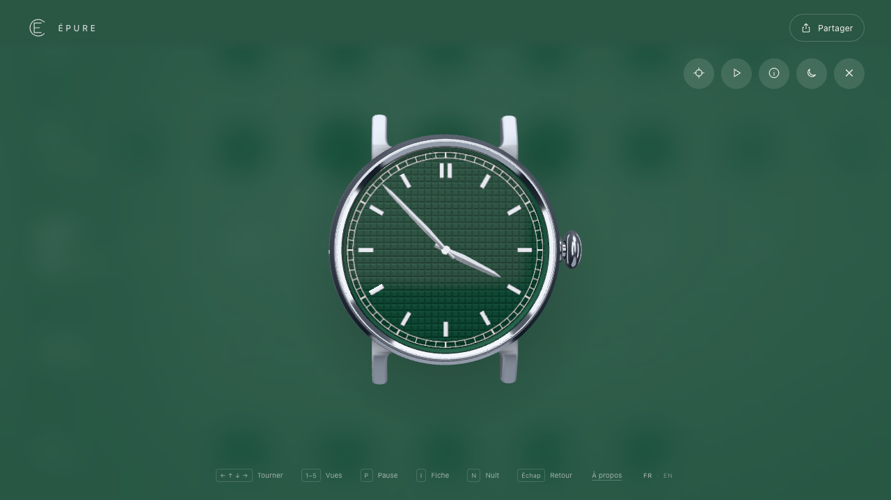
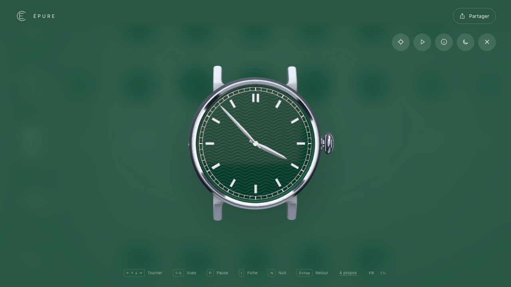
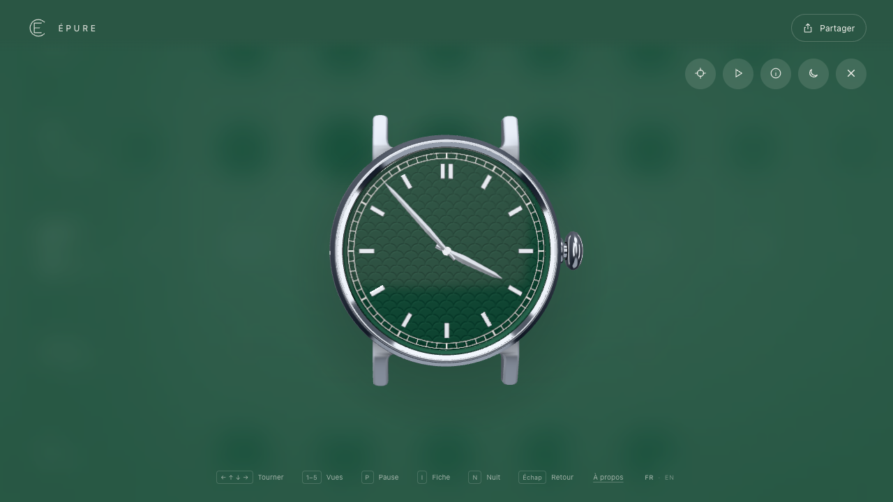

# Cinq nouvelles finitions de cadran

La ligne « Finition du cadran » propose cinq variantes supplémentaires, après
« Martelé ». Le brossé vertical existant reste disponible.

| Finition | Rendu | Identifiant de partage ajouté |
| --- | --- | --- |
| Effet cuir | Grain irrégulier, petites crevasses et surface mate non métallique | `w: 15` |
| Brossé circulaire | Stries concentriques fines, irrégulières et reflets directionnels | `w: 16` |
| Tapisserie | Petits carrés à plateau, séparés par des sillons | `w: 17` |
| Vagues | Ondulations horizontales régulières | `w: 18` |
| Écailles | Arcs décalés d’une rangée à l’autre | `w: 19` |

Les textures de relief et de rugosité sont indépendantes de la couleur. Les
motifs sont dimensionnés en millimètres, centrés sur le cadran et compatibles
avec les différentes formes et tailles. Le cuir reste un effet visuel du
configurateur : il ne modifie pas la construction du cadran ou son épaisseur.

Les identifiants des anciennes finitions sont conservés. Les cinq ajouts sont
traduits en anglais et suivent les couleurs du cadran dans l’ambiance de l’atelier.

Vérifications : tests de relief, normales, rugosité, matériaux sur toutes les
formes et tailles, conservation des couleurs, aller-retour des liens de partage
et parcours clavier. Captures WebGL en crème et vert sur ordinateur et mobile.

