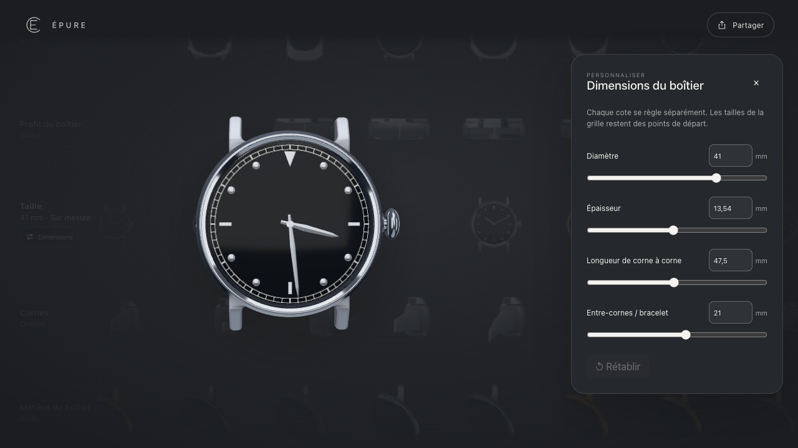
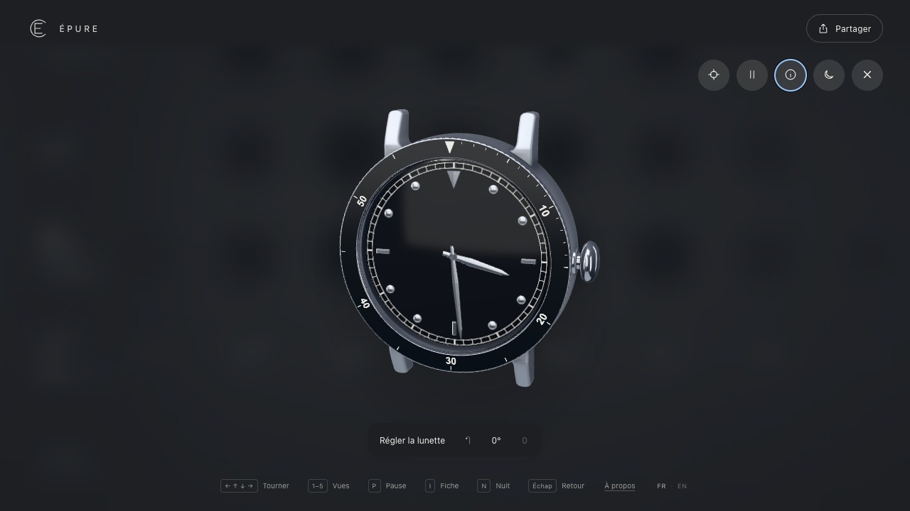

# Premier lot — affichage, dimensions et index

24 novembre 2026.

## Utilisation

- **Trotteuse → Sans trotteuse** : affichage à deux aiguilles. La petite seconde et le chronographe éventuels sont retirés ; la date et la réserve sont conservées. La couleur de seconde reste mémorisée. Ajouter ensuite une complication à secondes restaure une aiguille fine.
- **Taille → Dimensions** : diamètre, épaisseur, longueur de corne à corne et entre-cornes indépendants. Curseurs et saisie numérique, aperçu direct, fermeture pour conserver, Rétablir pour revenir aux cotes à l’ouverture. Une saisie incomplète ne remplace pas la dernière combinaison valide. Le bracelet suit la largeur d’entre-cornes.
- **Index → Plongée** : triangle à 12 h, bâtons à 3/6/9 h et points aux autres heures.
- **Index → Bâtons et points** : bâtons facettés aux heures cardinales, doublés à 12 h, et points aux autres heures.

Les compositions utilisent le réglage commun de taille et de position des index. Elles laissent leur place aux chiffres et complications existants. Avec tous les chiffres, arabes ou romains, la ligne Index reste masquée et son choix est mémorisé. Les dispositions partielles conservent les index, quelle que soit l’écriture.

Une taille personnalisée est nommée « Sur mesure » et conserve un voisinage de tailles prédéfinies proche de son diamètre. Se déplacer entre les lignes ne réapplique pas un préréglage. Choisir explicitement une taille de la grille applique ses quatre cotes.

La fiche d’identité distingue désormais la longueur de corne à corne de l’entre-cornes / largeur de bracelet.

## Liens

Les cotes utilisent les champs v1 déjà existants. Les nouveaux identifiants sont ajoutés en fin de correspondance : index `A=9` (Plongée), `A=10` (Bâtons et points) ; trotteuse `L=11` (Sans trotteuse). Aucun identifiant historique ni valeur par défaut v1 n’a changé.

Exemple local combinant deux aiguilles, index Plongée et lunette tournante :

[Ouvrir l’exemple](http://127.0.0.1:5173/#v1.eyJuIjo3LCJBIjo5LCJMIjoxMSwiTiI6MCwiYWciOjJ9).

## Vérification

- Suite unitaire complète : 524 tests passent.
- TypeScript, Svelte et ESLint : aucune erreur.
- Scénarios navigateur de configuration, de partage et de visibilité des index : 22 passent, répartis entre ordinateur et mobile.
- Vérification manuelle dans le navigateur intégré : suppression de la seconde, panneau de dimensions, enregistrement exact dans l’URL et rendu Plongée à deux aiguilles.

Le scénario historique qui ouvre `/review.html` est réservé au serveur de développement ; le build de production ne contient pas cette entrée. Il est exclu des scénarios ci-dessus. Un ancien test de navigation a été ajusté pour atteindre le début de la grille malgré les lignes ajoutées depuis sa création.

Commande des scénarios navigateur vérifiés sur cette machine :

```sh
PLAYWRIGHT_CHROMIUM_EXECUTABLE_PATH='/Applications/Google Chrome.app/Contents/MacOS/Google Chrome' npm run test:e2e -- e2e/first-options.spec.ts e2e/config-url.spec.ts e2e/indices-visibility.spec.ts --workers=2 --grep-invert='le comparateur'
```

## Captures





Versions mobiles : [dimensions](dimensions-mobile.png), [montre](dive-mobile.png).

Les finitions et inserts lumineux sont décrits dans le [lot luminescence](../lume/README.md). Les lunettes fixes graduées et les bracelets en 3D restent à venir.
