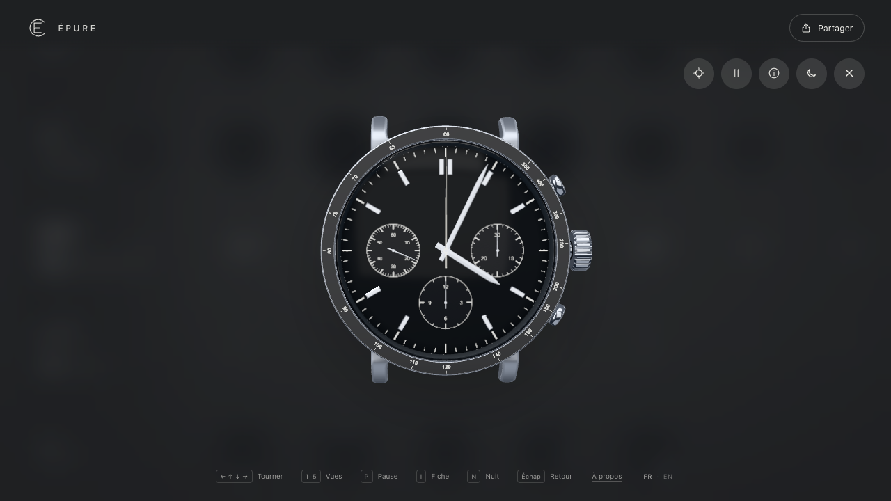
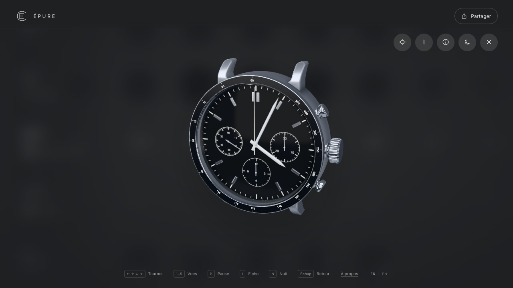
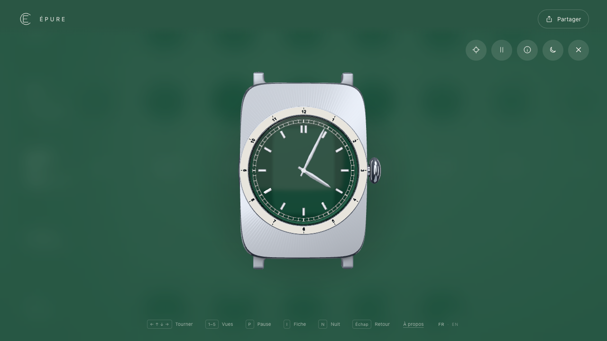

# Lunette fixe graduée

La ligne **Lunette** propose **Fixe graduée · ouverture ronde**, juste avant la
tournante. Une ligne **Graduation de lunette** apparaît : tachymètre, 60 minutes,
12 heures ou 24 heures. Le bouton de couleur de la lunette règle l’insert avec
aperçu et rétablissement, comme pour la tournante.

Le tachymètre est placé sur un insert extérieur au verre. Ses repères utilisent
`v = 3600 / t`, avec `t` en secondes : 60 à douze heures, 120 à six heures, 500 à
7,2 secondes. Il est disponible avec ou sans chronographe ; la commande interactive
du chronographe reste un lot distinct.

L’anneau fixe a des flancs lisses, sans crans de prise, et n’expose aucune commande
de rotation. Un ancien angle mémorisé est ignoré pour cette variante et conservé
pour un retour à la tournante. Le matériau de l’insert est laqué ; ses autres
matières et les dimensions propres à la lunette restent à traiter.

L’ouverture reste ronde sur chaque forme de boîtier. Le cadran, le verre et le
réhaut suivent cette ouverture ; la forme de cadran choisie reste mémorisée et
redevient visible lorsqu’on revient à une lunette classique. Les cotes et jeux
autour du verre sont partagés avec l’anneau tournant déjà vérifié.

## Compatibilité et vérification

- Nouveau type v1 : `n: 10`. Les graduations réutilisent les jetons existants
  `p: 5` (tachymètre), `p: 2` (60 min), `p: 3` (12 h), `p: 4` (24 h).
- Aucun identifiant historique ni valeur par défaut v1 n’est modifié. Sans
  graduation reconnue, le fixe affiche un tachymètre et la tournante ses 60 min.
- Les deux lignes de graduations sont exclusives : une seule apparaît à l’écran.
- Interface et fiche d’identité disponibles en français et en anglais.
- Géométrie : toutes les formes, 22/48 mm, les trois ouvertures et quatre profils ;
  dégagement du verre, positions et normales finies, angle fixe invariant.
- Parcours navigateur : choix, quatre échelles, couleur, partage, rechargement,
  changement fixe/tournante/classique, conservation de la forme mémorisée et absence
  de commande de rotation sur le fixe. Captures sur ordinateur et mobile.

Validation : 605 tests unitaires et 16 parcours navigateur passent. Typage Svelte /
TypeScript, lint, formatage et build vérifiés. Les tests de partage attendent
désormais la fin de l’animation de fermeture avant de naviguer dans la grille.

Versions mobiles : [chronographe](chronograph-mobile.png),
[insert clair](rectangle-light-mobile.png).
