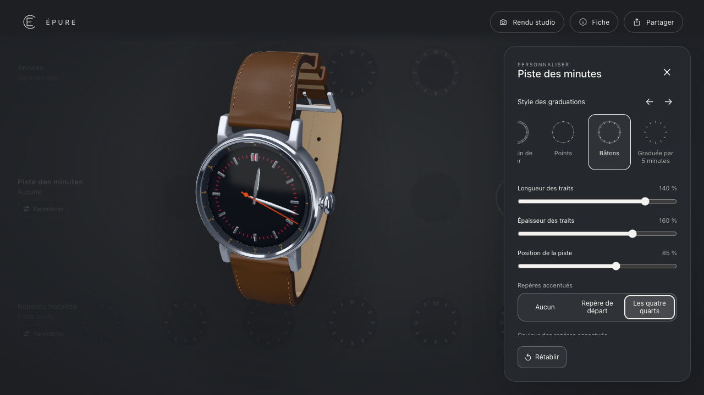
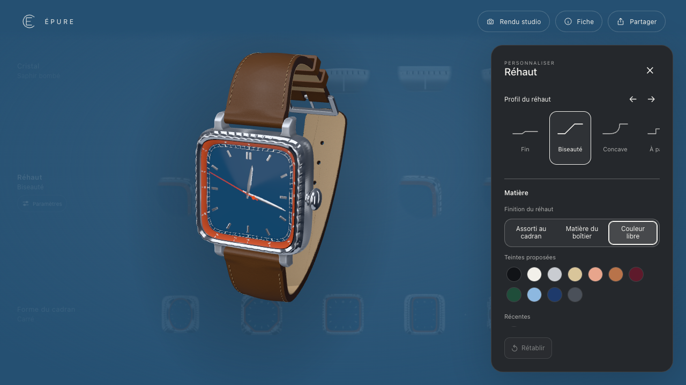

# Piste des minutes et graduations du réhaut

Les lignes **Piste des minutes** et **Réhaut** restent indépendantes dans la grille.
Le profil, la matière et les graduations du réhaut sont réunis dans une seule ligne.
Chacune des deux lignes ouvre son propre panneau
**Paramètres**, avec un carrousel de styles en aperçu, les réglages d'apparence et le bouton
**Rétablir**. Les choix de la grille et du panneau se synchronisent à la fermeture, ainsi
que dans l'aperçu 3D.

## Piste des minutes

- Styles : Aucune, Chemin de fer, Points, Bâtons, Graduée par 5 minutes.
- Traits : longueur et épaisseur ; points : taille conservant la hiérarchie des cinq minutes.
- Position de la piste vers le centre ou le bord.
- Couleur suivant l'encre du cadran ou couleur libre.
- Repère de départ ou quatre quarts accentués, avec couleur automatique ou libre.

Le panneau reste accessible sur **Aucune**. Les réglages sont conservés en changeant de
style ou en retirant la piste.

## Réhaut : matière et graduations

- Styles : Sans graduations, Minutes, Minutes chiffrées, 24 heures, Tachymètre.
- Couleur des inscriptions automatique ou libre ; accents au départ ou aux quatre quarts.
- Longueur et épaisseur des traits, taille des inscriptions pour les styles chiffrés.

Le panneau **Réhaut** présente les profils en aperçu, puis deux sections distinctes **Matière** et
**Graduations**, toutes deux présentes dans le panneau. Les profils et les graduations peuvent être changés dans ce même panneau ;
**Rétablir** restaure leur état commun à l’ouverture. Le profil fin masque l’impression en
conservant les choix ; un message explique comment choisir un profil compatible.
L’ancienne ligne `rehaut-scale` reste dans le catalogue pour les liens et la fiche
d’identité, mais n’apparaît plus dans la grille.

## Compatibilité et vérification

Les identifiants de styles des liens restent identiques (`z` pour la piste, `af` pour le
réhaut). Les nouveaux réglages facultatifs sont dans `bf.chapterRing` (`length`,
`lineWidth`, `radius`, `accentAt`, `accent`) et `bf.rehaut.tickLength`. La taille des points,
les couleurs et les autres réglages du réhaut existants sont conservés. Les valeurs de
référence donnent exactement le tracé historique ; le lien par défaut reste `#2`.
L’ordre des réglages dans les nouveaux liens est normalisé pour garder la même adresse
après rechargement. Les anciens liens gardent leur interprétation.

Tests : indépendance des deux lignes et de leurs données, tracés à leurs valeurs de
référence, dimensions et accents, anciens liens et aller-retour, rétablissement,
rechargement et synchronisation de la grille depuis les panneaux. Parcours ordinateur et
mobile, y compris en aperçu 3D.

