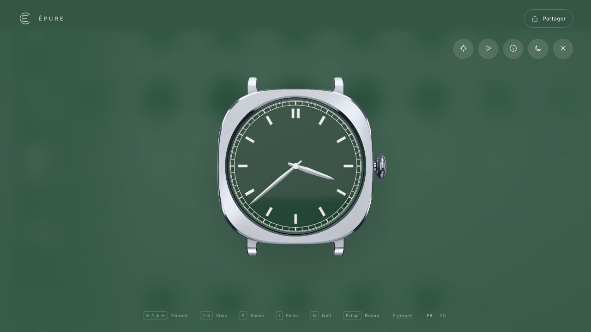
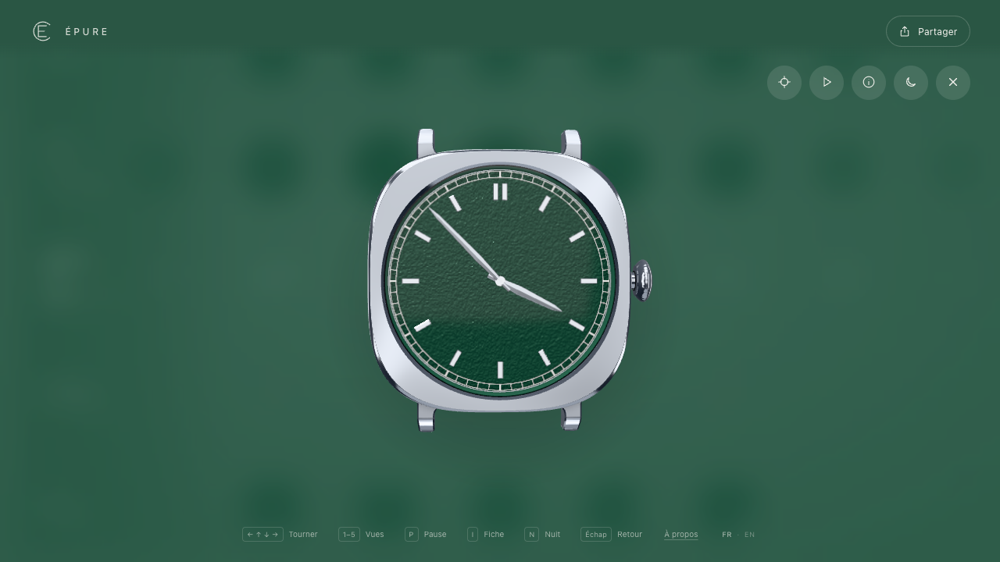

# Lisibilité du cadran grainé

Le grain du boîtier coussin utilisait encore un ancien réglage de comparaison :
texture répétée 7 fois et relief normal à 0,22, contre 3 et 1,4 sur les autres
boîtiers. À la taille d’affichage courante, ses détails devenaient presque
invisibles avec le filtrage de la texture.

La finition courante utilise maintenant le même réglage pour toutes les formes :
répétition à 1,5, amplitude normale à 0,65 (0,35 pour les teintes claires) et métal
à 0,45. Le relief reste visible
dans la grille et en vue 3D. Les textures restent en 512 × 512 et la couleur du
cadran reste indépendante. Les autres finitions ne changent pas de réglage ; le
mode historique `model=legacy` conserve son matériau de comparaison.

Vérification manuelle dans le navigateur intégré : coussin vert, avant/après.
Captures navigateur sur ordinateur et mobile : coussin vert, rond crème, rond
sombre. Test de régression : changer seulement le boîtier conserve le matériau du
même cadran rond. Les tests des six autres finitions et de leurs caches sont
également vérifiés.

Autres captures : [crème](round-cream-desktop.png), [sombre](round-black-desktop.png),
[coussin sur mobile](cushion-green-mobile.png), [crème sur mobile](round-cream-mobile.png).
