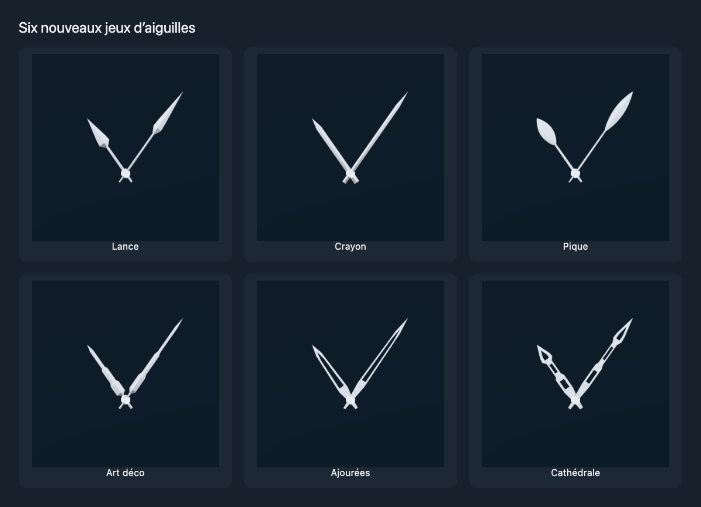
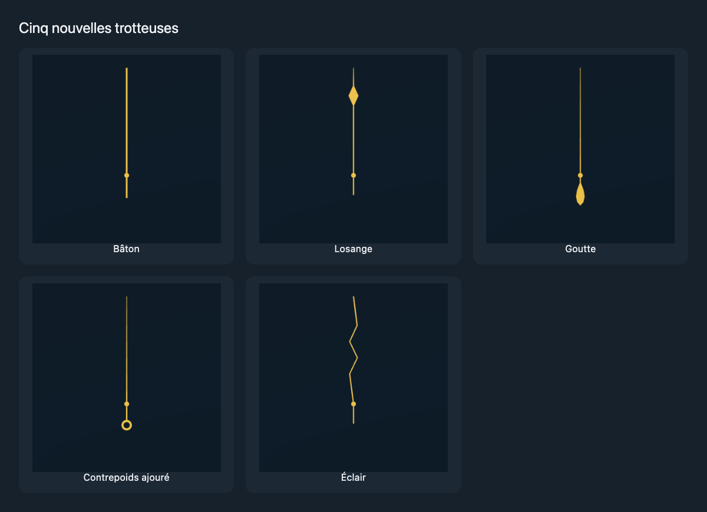

# Nouveaux jeux d’aiguilles et trotteuses

Le catalogue propose désormais **12 jeux d’aiguilles** et **10 trotteuses**. Les variantes précédentes conservent leur ordre et leurs identifiants.

Nouveaux jeux : Lance, Crayon, Pique, Art déco, Ajourées et Cathédrale. Les ajourées ont une ouverture longitudinale ; les cathédrales ont trois fenêtres traversantes. Les ouvertures font partie de la géométrie et restent visibles avec toutes les matières et couleurs.

Nouvelles trotteuses : Bâton, Losange, Goutte, Contrepoids ajouré et Éclair. Le contrepoids ajouré est une seule pièce percée, reliée à sa tige sans barre au travers de l’ouverture.

Les nouveaux profils utilisent les mêmes longueurs, plans de montage et traitements de matière que les autres aiguilles. Leur dimension suit le cercle inscrit du cadran, pour conserver le passage au bord pendant la rotation. Les biseaux restent dans l’épaisseur prévue, sans ajouter de passe de rendu.

Les tests vérifient la correspondance catalogue/géométrie, les coordonnées finies, le rayon disponible et la séparation des aiguilles sur les six formes aux diamètres 22, 40 et 48 mm. Des lancers de rayons vérifient les ouvertures et la présence de métal sur leurs côtés. Les identifiants URL existants restent inchangés ; les nouveaux sont ajoutés à la suite (`I` : 7–12, `L` : 6–10).

Les planches proviennent du moteur 3D, avec une caméra, un éclairage et des angles communs. Reproduction avec Vite actif : `node scripts/hand-variants-review.mjs` ; `PLAYWRIGHT_CHROMIUM_EXECUTABLE_PATH` permet de choisir un Chromium installé.

