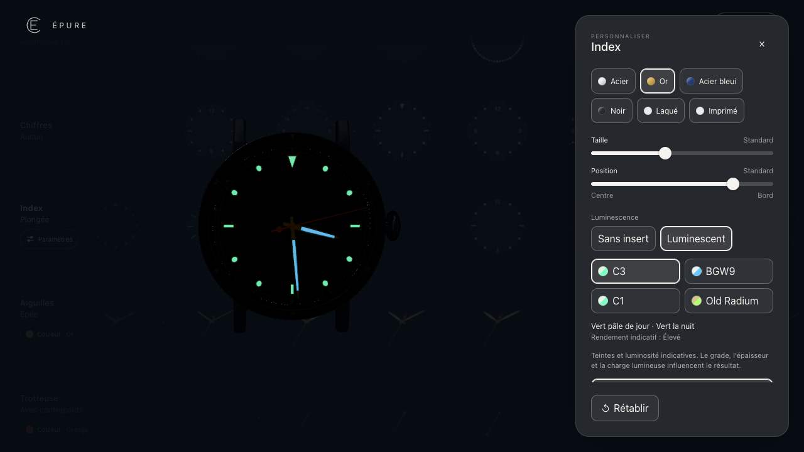
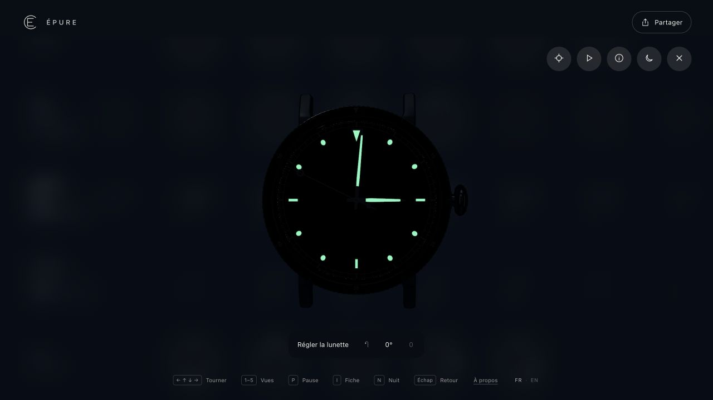

# Matières et inserts lumineux

## Utilisation

- **Index → Paramètres** : acier, or, acier bleui, noir, laqué ou imprimé. Les
  finitions laquée et imprimée proposent une couleur libre. Taille et position
  restent indépendantes.
- **Index / Aiguilles → Luminescence** : activer les inserts, puis choisir un
  pigment : C3, BGW9, C1 ou Old Radium. Le couple jour/nuit est associé à cette
  référence ; il ne se modifie pas séparément. Retirer puis réactiver les inserts
  retrouve le pigment à partir de ses teintes mémorisées.
- Les anciens liens à couleurs lumineuses libres sont convertis vers le pigment
  prédéfini le plus proche. Aucun sélecteur de couleurs libres n’est proposé pour
  la matière lumineuse.
- **Aperçu nocturne** : bouton dans les panneaux et icône lune dans la vue 3D,
  également accessible avec **N**. Cet aperçu est temporaire ; les choix de
  matières et de couleurs sont conservés dans le lien.
- **Rétablir** revient à l’ensemble des réglages présents à l’ouverture du
  panneau. Fermer conserve les réglages affichés, comme pour les couleurs.

Les deux aiguilles principales portent des inserts adaptés à leur dessin. Les
jeux ajouré et cathédrale utilisent leurs ouvertures ; le jeu Breguet reçoit une
pastille dans son anneau. Tous les jeux actuels sont couverts. La trotteuse et
les aiguilles des complications conservent leur matière actuelle.

Les neuf styles et compositions d’index sont couverts, avec les mêmes exclusions
aux emplacements des chiffres et des complications. Les index appliqués lumineux
ont un entourage métallique percé et un remplissage distinct, légèrement en
retrait. Les index imprimés sont plats ; lorsqu’ils sont lumineux, leur couleur
de jour est celle de la matière lumineuse.

La fiche d’identité décrit la finition des index et les couleurs des inserts.
L’interface de ce lot est disponible en français et en anglais.

## Pigments et limites de l’aperçu

| Référence proposée | Jour | Nuit | Rendement présenté |
| --- | --- | --- | --- |
| C3 | Vert pâle | Vert | Élevé |
| BGW9 | Blanc | Bleu | Élevé |
| C1, formulation classique à émission verte | Blanc | Vert | Modéré |
| Old Radium, variante à émission verte | Beige patiné | Vert | À confirmer selon formulation |

Les couples C3/BGW9 sont décrits par [Oris](https://helpcenter.oris.ch/hc/en-gb/articles/16999116008849-What-is-the-difference-between-Super-LumiNova-C3-and-Super-LumiNova-BG-W9).
Les variantes GL C1 et Old Radium à émission verte figurent dans le
[catalogue de matières KD89](https://www.groupekd89.com/entretien-consommables/lumineux-pour-aiguilles/).
RC Tritec décrit également [l’aspect patiné d’Old Radium](https://www.rctritec.com/en/superluminova/news/old-radium-history-and-origin).

Les RGB sont des approximations pour l’écran, pas des échantillons colorimétriques.
Les coefficients de luminosité sont une pondération visuelle : BGW9 un peu plus
discret que C3, C1 classique plus discret. Ils ne représentent pas des pourcentages
mesurés. Aucune valeur comparative n’est attribuée à Old Radium ; son niveau
d’aperçu générique ne garantit pas un rendement égal à C3.

Le grade, l’épaisseur de dépôt et la charge lumineuse influencent le résultat,
comme le rappelle la [présentation du fabricant](https://www.jcucl.com/image/catalog/product/pdf/Presentation_Swiss_Super-LumiNova_2024_ENG.pdf),
notamment aux pages 8 à 17. Le simulateur ne calcule pas la décroissance dans le
temps.

## Rendu et compatibilité

La scène nocturne baisse la lumière directe et celle de l’environnement. Les
inserts émettent alors la couleur choisie. Les matériaux et miniatures de jour
restent séparés des matériaux nocturnes ; les émissions sont nulles de jour.
Cet aperçu montre la lecture dans l’obscurité, avec une émission constante.

Les champs v1 `B` (finition des index), `C` (lume des index) et `K` (lume des
aiguilles) sont conservés. Une valeur de lume non vide active les inserts ; `null`
les retire. Les ajouts sont :

| Champ | Paramètre |
| --- | --- |
| `ap` | Couleur des index laqués ou imprimés |
| `aq` | Couleur de jour des inserts d’index |
| `ar` | Émission nocturne des index |
| `as` | Couleur de jour des inserts d’aiguilles |
| `at` | Émission nocturne des aiguilles |

Les valeurs par défaut sont ajoutées à l’enveloppe v1 sans modifier le fichier
historique ni les identifiants existants. Les anciens liens sans lume restent
sans inserts. Le lien par défaut reste `#v1.e30`.

Les nouvelles sélections stockent la référence dans `C` ou `K`, avec ses teintes
associées dans les champs existants. Une référence reconnue détermine les couleurs
effectives, même si des RGB contradictoires ont été placés dans un lien. Les alias
comme `BG W9` sont reconnus. Les liens `custom` ou aux noms inconnus migrent vers
la référence la plus proche, avec le message d’ajustement existant. Le choix
utilise l’écart perceptuel CIEDE2000 de jour et de nuit, pondéré en faveur de la
lecture nocturne. Les teintes mémorisées lorsque les inserts sont désactivés sont
également ramenées à un couple prédéfini. Le nouveau lien est stable au rechargement.
Aucun identifiant v1 n’est réaffecté.

## Vérification

Tests géométriques sur les 12 jeux d’aiguilles à 22, 40 et 48 mm : inserts exposés
dans leurs ouvertures, positions finies, portée et hauteur respectées. Tests des
neuf styles d’index : taille et position extrêmes, exclusions, impression plate.
Tests de configuration : réglages indépendants, désactivation sans perte des
couleurs et compatibilité des liens.

Parcours navigateur sur ordinateur et mobile : pigments, couples associés,
migration des anciens liens personnalisés, finitions, rétablissement,
rechargement, français/anglais et raccourci nocturne. Vérification manuelle dans
le navigateur intégré : index C3 et aiguilles BGW9.

La suppression du mode libre est validée par **99 tests unitaires ciblés** et
**18 parcours navigateur**, répartis entre ordinateur et mobile.
TypeScript, Svelte, ESLint et le formatage des fichiers modifiés sont vérifiés.

Versions mobiles : [panneau](panel-mobile.png), [vue nocturne](night-mobile.png).
