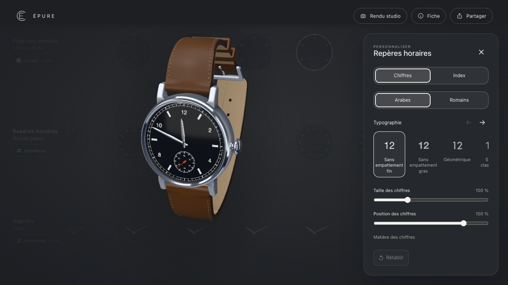
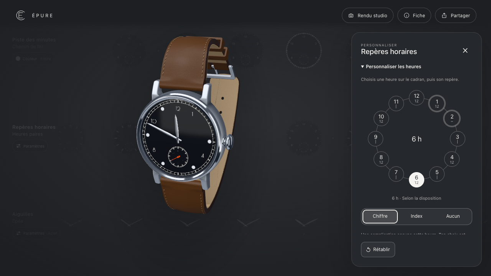
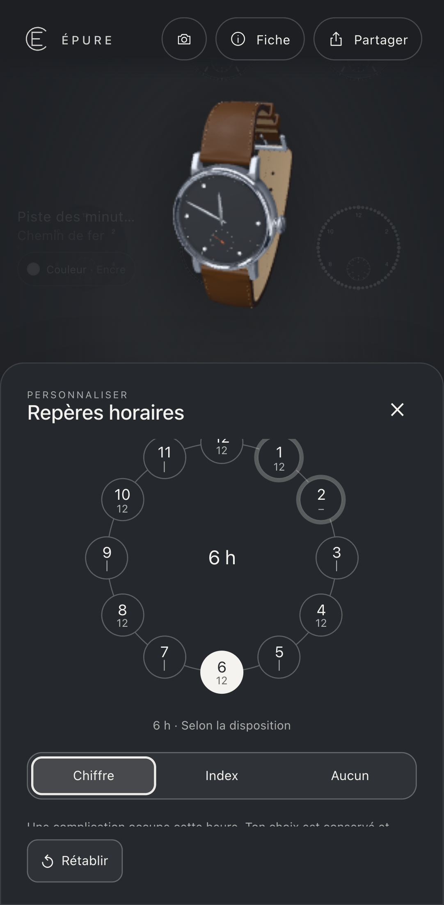

# Repères horaires

La grille rassemble désormais la disposition des chiffres et des index dans la ligne
**Repères horaires**. Les anciennes lignes **Style des chiffres** et **Index** restent
présentes dans le catalogue pour les liens, mais leurs choix se trouvent dans le panneau
commun.

Dispositions : Index seuls, 12/3/6/9, 3/6/9, 12 seul, 6 et 12, Heures paires,
Tous les chiffres. **Heures paires** place 12, 2, 4, 6, 8 et 10 ; les index occupent
les heures restantes. Une petite seconde à 6 h masque automatiquement le 6.

## Personnalisation

- **Chiffres** : arabes/romains, typographie avec aperçu, taille, position, matière et couleur.
- **Index** : forme avec aperçu, finition, longueur, largeur, position, couleur et luminescence.
- **Personnaliser les heures** : sélectionner une heure sur le cadran, puis Chiffre, Index
  ou Aucun. **Suivre la disposition** retire l'exception de cette heure. Les réglages
  individuels d'apparence des index restent disponibles sous le choix du repère.

Les deux onglets sont toujours accessibles, même si leurs repères sont absents de la
disposition courante. Les réglages sont conservés lors d'un changement de disposition ;
seules les exceptions Chiffre/Index/Aucun sont retirées quand une disposition est choisie
à nouveau dans la grille. Les complications masquent les repères sans effacer leurs choix.
**Rétablir** restaure l'ensemble du panneau tel qu'il était à son ouverture.

## Compatibilité des liens

- Les identifiants existants de disposition, de typographie et d'index sont inchangés.
- Le champ `D: 8` ajoute la disposition Heures paires.
- `ao` conserve l'écriture, indépendamment de la disposition.
- L'ancien `D: 7` reste lu comme un cadran romain complet, puis enregistré sous
  `D: 2, ao: 2`.
- Les exceptions de type sont dans `bf.hourMarkers` : clés `1` à `12`, valeurs
  `numeral`, `index` ou `none`. Les anciennes exceptions d'apparence dans `bf.indices`
  sont conservées, même si un chiffre ou une complication occupe l'heure.
- Les liens v1 et le format compact `#2…` restent lisibles ; la configuration par défaut
  reste `#2`.

## Vérification

Tests unitaires sur les heures paires, chiffres romains, exceptions, géométrie des index,
priorité des complications, conservation des choix et aller-retour des liens. Parcours
Playwright sur ordinateur et mobile : panneau commun, typographies et formes,
personnalisation horaire, anciens liens, rétablissement, changements de disposition et
rechargement.

