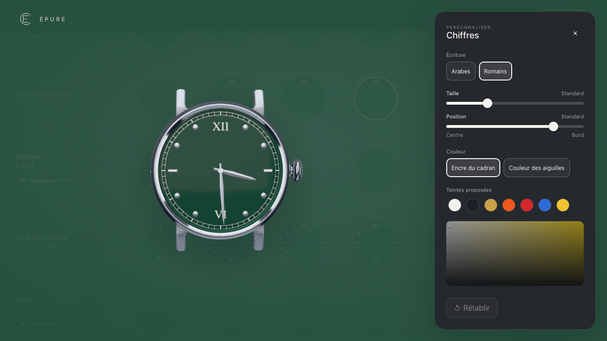
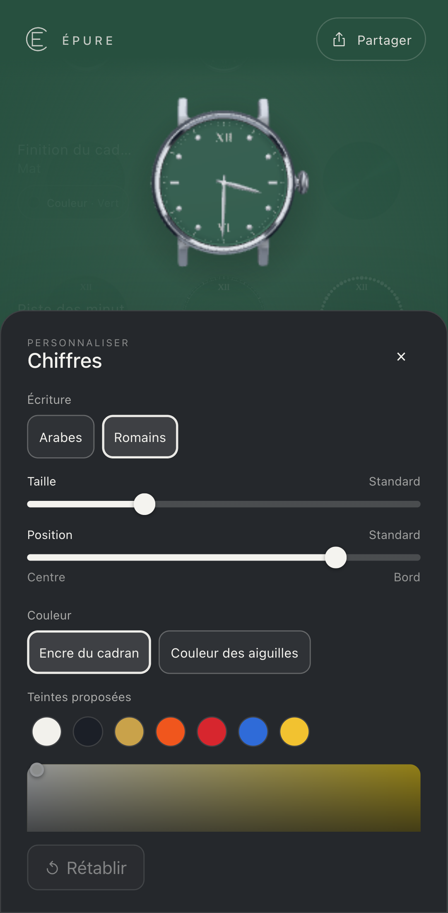

# Écriture et disposition des chiffres

La ligne **Chiffres** choisit les heures imprimées : Aucun, 12/3/6/9, 3/6/9,
12 seul, 6 et 12, ou Tous. Son bouton **Paramètres** ouvre le choix
**Arabes / Romains**, ainsi que la taille, la position et la couleur.
La ligne **Style des chiffres** conserve le choix de typographie.

L’écriture reste sélectionnée lorsqu’on change de disposition. Les index sont
disponibles avec les dispositions partielles ; chaque index occupé par un chiffre
ou une complication est retiré comme auparavant. Un cadran avec tous les chiffres
masque la ligne Index, en conservant le modèle d’index choisi pour un retour à une
disposition partielle.

## Compatibilité des liens

- Le champ v1 `D` garde les mêmes identifiants de disposition.
- Le nouveau champ `ao` choisit l’écriture : `1` pour arabe (valeur par défaut,
  omise), `2` pour romaine.
- L’ancien `D: 7` est toujours lu comme un cadran romain complet, puis enregistré
  sous `D: 2, ao: 2`. Le rendu historique est conservé.
- Le lien de configuration par défaut reste `#v1.e30`.

## Vérification

Tests unitaires : toutes les dispositions romaines, suppression des chiffres aux
emplacements des complications, impression historique identique, conservation des
réglages et aller-retour des liens. Tests navigateur sur ordinateur et mobile :
anciens liens, choix d’écriture, dispositions partielles avec index, rétablissement,
rechargement et masquage des paramètres lorsque les chiffres sont absents.

