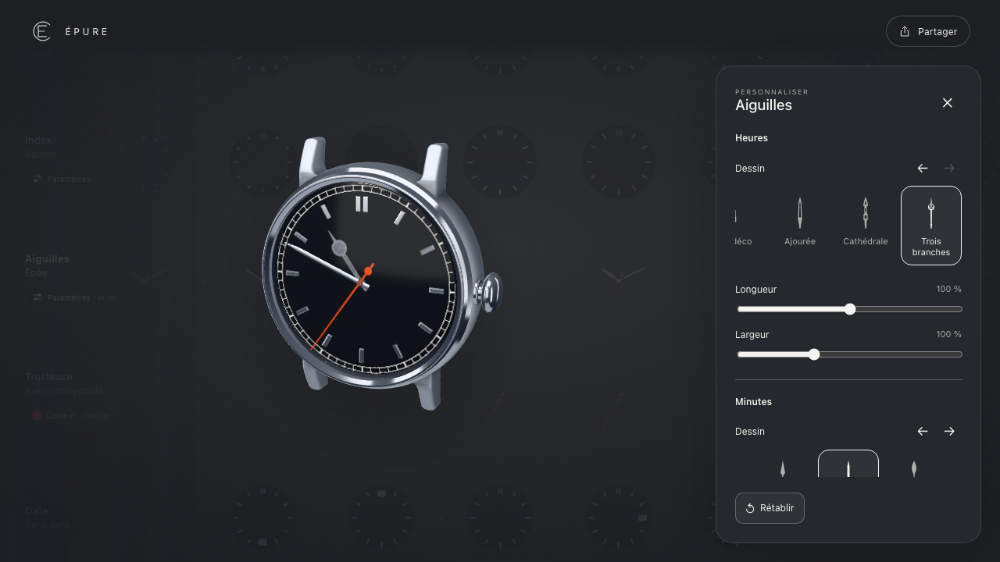
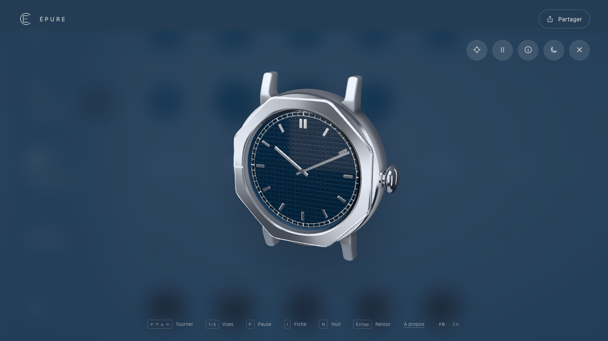
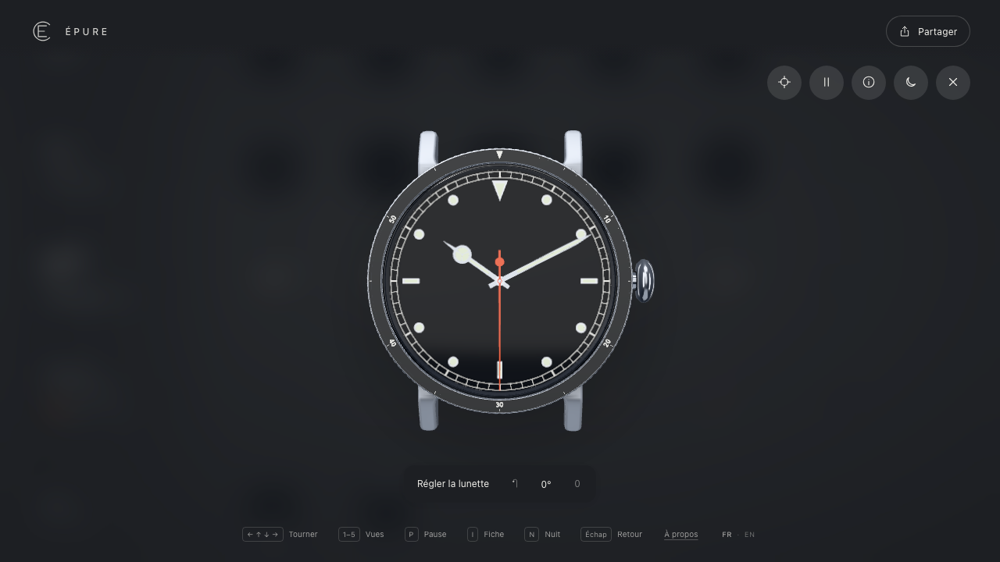
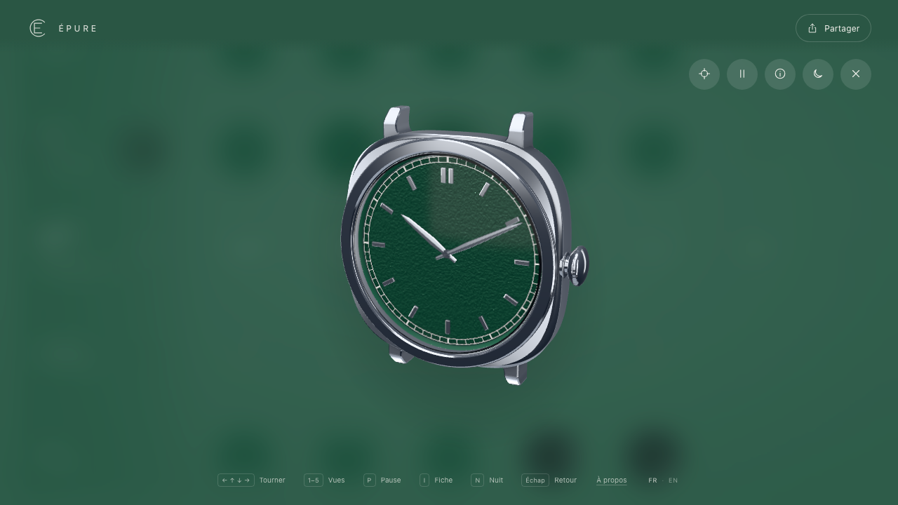

# Aiguilles et lunettes indépendantes

## Aiguilles

Le bouton **Paramètres** de la ligne Aiguilles ouvre deux carrousels horizontaux,
un pour les heures, l’autre pour les minutes. Chaque dessin a une silhouette ; la
carte sélectionnée porte une bordure. Flèches, Début et Fin permettent de choisir
au clavier ; les boutons latéraux et le défilement horizontal restent disponibles.

Les sections **Heures**, **Minutes** et **Finition des aiguilles** sont en gras.
Des séparateurs fins organisent les sections, sans cadre autour des blocs.

Chaque aiguille possède son dessin, sa longueur et sa largeur. « Suivre le jeu
choisi » reprend le jeu de la grille. Choisir un autre jeu dans la grille rétablit
les deux dessins communs, en conservant les proportions personnalisées.

Le nouveau dessin **Trois branches** possède une tête circulaire à trois secteurs
réellement creusés, avec inserts en retrait lorsque la luminescence est active.
Il peut être associé, par exemple, à une aiguille des minutes Crayon.

Les proportions sont relatives aux références de chaque aiguille : heures
65–135 %, minutes 65–105 %, largeur 60–180 %. Leurs limites maintiennent les pointes
dans le cercle inscrit du cadran. Les moyeux et niveaux de superposition sont
conservés. Finition, couleur et pigment lumineux restent communs aux deux aiguilles.
La trotteuse et les aiguilles de complications ne changent pas de dessin.

## Lunettes

Le bouton **Paramètres** est disponible pour toutes les lunettes. Il règle :

- La forme extérieure : suivre le boîtier, ronde, coussin, octogonale, carrée,
  rectangulaire ou tonneau.
- La largeur relative, avec une indication en millimètres de la largeur de référence.
- La hauteur relative : 100–160 % du profil standard, pour surélever la lunette.
- La finition sur la matière du boîtier : suivre le boîtier, mixte, polie, brossée,
  sablée ou noire PVD. Ce choix ne modifie pas la finition de la carrure.

La forme est ajustée pour rester sur la carrure. Le cadran, le verre et le réhaut
se redimensionnent en conséquence ; le boîtier conserve sa forme et ses cotes
globales. La hauteur supplémentaire remonte le verre et réduit la part de carrure
dans l’épaisseur totale choisie. Une construction séparée est utilisée lorsqu’un
réglage indépendant est actif ; les valeurs standard conservent la géométrie
historique.

Les lunettes à insert gradué conservent leur contour circulaire. Le choix de forme
reste mémorisé pour le retour à une lunette classique. Leur largeur, hauteur et
finition restent réglables ; leur couleur d’insert garde son sélecteur. La céramique
et le carbone conservent leur traitement propre et masquent le choix de finition.

Les vis, matériaux distincts de lunette et matières d’insert ne sont pas ajoutés
dans ce lot.

## Sauvegarde et contrôles

Tous les changements se prévisualisent sans modifier l’URL avant fermeture.
**Rétablir** retrouve l’ensemble des réglages présents à l’ouverture.

Les jetons v1 ajoutés sont `au` / `av` pour les réglages des deux aiguilles,
`aw` pour la forme de lunette, `ax` pour sa largeur, `ay` pour sa hauteur et `az`
pour sa finition. Les identifiants et valeurs implicites historiques restent
inchangés ; le lien par défaut reste `#v1.e30`.

Vérifications géométriques : tous les dessins d’aiguilles aux extrêmes de taille
et de largeur, secteurs lumineux exposés, jeu entre lunette et verre, toutes les
paires de formes de boîtier/lunette à 22 et 48 mm. Les parcours navigateur couvrent
carrousels au clavier, aperçu, rétablissement, liens, rechargement, forme ronde
imposée aux lunettes tournantes et retour au choix mémorisé, en français/anglais,
sur ordinateur/mobile. Le message d’ajustement des anciens liens n’intercepte
plus les clics sur les commandes du panneau.

Validation : **648 tests unitaires** et **34 parcours navigateur** passent, ainsi
que le typage, le lint et le build. Les dernières retouches visuelles sont
vérifiées par les six parcours du lot sur ordinateur/mobile.

Version mobile : [carrousels et séparateurs](hands-panel-mobile.png).

