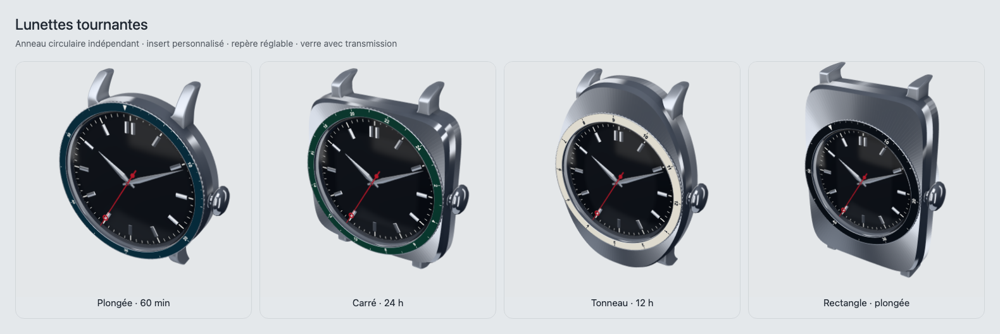

# Lunettes tournantes

La ligne Lunette propose « Tournante · ouverture ronde ». Une ligne Graduation de lunette apparaît alors : plongée 60 minutes, 12 heures ou 24 heures. La couleur de l’insert se règle dans la palette habituelle, avec prévisualisation et annulation.

La lunette tourne par crans de 3°, en sens antihoraire pour la plongée et dans les deux sens pour les graduations horaires. Dans la vue 3D, « Régler la lunette » (ou B) permet de glisser directement sur l’anneau. Les boutons, les flèches du clavier et la remise à zéro restent disponibles. Le boîtier, le verre, le réhaut et les aiguilles restent indépendants de cette rotation.

L’anneau est toujours circulaire et garde un jeu de 0,035 mm autour du bord du verre. Les boîtiers non ronds conservent leur forme extérieure. La forme de cadran précédente est conservée dans la configuration et réapparaît lorsqu’on revient à une lunette fixe.

La position voyage dans les liens v1 sous le jeton `ai`. Les anciens liens gardent leur lunette et une position initiale de zéro. Une rotation actualise la transformation de l’anneau sans reconstruire le modèle ni ses textures ; les ressources propres aux graduations sont libérées avec la montre.

Le script `node scripts/rotating-bezel-review.mjs` reproduit les captures avec un serveur Vite local. Les parcours Playwright vérifient le partage, la couleur, la restauration du cadran et le glisser à la souris ou au doigt, y compris le sens unique de plongée et l’occultation par le fond du boîtier.
