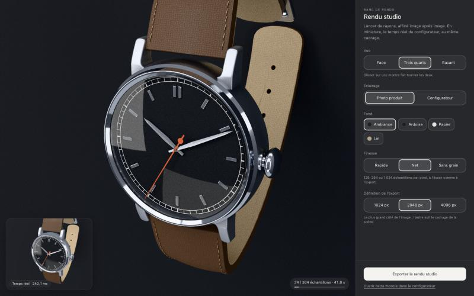

# Rendu studio par lancer de rayons

Prototype d’un rendu « photo » de la montre, calculé dans le navigateur avec [three-gpu-pathtracer](https://github.com/gkjohnson/three-gpu-pathtracer) sur la scène Three.js du configurateur. Il ne demande ni serveur ni fichier à télécharger : le modèle, les matières et le studio sont ceux du site.



## Ouvrir le banc

Avec `npm run dev`, ouvrir [`/studio.html`](http://127.0.0.1:5173/studio.html). Pour rendre une montre précise, copier le `#v1.…` de l’adresse du configurateur à la fin de celle du banc :

```
http://127.0.0.1:5173/studio.html#v1.…
```

La page reste hors du build publié, comme `review.html`. Elle suit le [design system](../design-system.md) du configurateur. Le **rendu studio occupe toute la scène** ; le **rendu en temps réel** s’y pose **en miniature**, en bas à gauche, au même cadrage (elle reprend les proportions de la scène), et l’avancement du calcul s’affiche en bas à droite. Les réglages tiennent dans un **panneau latéral fixe** à droite, aux tons des panneaux du site (clair ou sombre selon le cadran) : mêmes tokens `--ink`, `--ink-soft`, `--veil`, mêmes libellés et pastilles que `Sheet`. Sous 760 px, la scène passe en haut et le panneau dessous.

- **Vue** (`SegmentedControl`) : Face, Trois quarts, Rasant. La caméra est commune aux deux vues ; tournée à la souris, elle quitte la vue prédéfinie. L’objectif reste du côté du cadran, la table ne passe jamais devant.
- **Éclairage** (`SegmentedControl`) : *Photo produit* (par défaut), réglé pour le lancer de rayons, ou *Configurateur*, le studio du site tel quel.
- **Fond** (boutons `compact` à pastille, `aria-pressed`) : l’ambiance du cadran, ou ardoise, papier, lin.
- **Finesse** (`SegmentedControl`) : Rapide, Net, Sans grain, soit 128, 384 ou 1 024 échantillons par pixel, à l’écran comme à l’export.
- **Définition de l’export** (`SegmentedControl`) : 1024, 2048 ou 4096 px pour le plus grand côté ; l’autre suit le cadrage de la scène (une scène de 1080 × 900 donne 1024 × 853 px).
- **Exporter le rendu studio** (bouton `primary`, `aria-busy` pendant le calcul) : recalcule l’image à la définition choisie et télécharge un PNG. L’affichage ne change pas de taille pendant le calcul.

Paramètres d’adresse pour les essais : `?tex=1024` réduit la taille des textures regroupées par le moteur (2048 par défaut, l’impression du cadran y perd en netteté) ; `?key=1.5` règle la lumière principale.

## Organisation

| Fichier | Rôle |
| --- | --- |
| [`studio.html`](../../studio.html) | page du banc |
| [`main.ts`](../../src/review/studio/main.ts) | lit la montre du lien et monte le composant |
| [`StudioBench.svelte`](../../src/review/studio/StudioBench.svelte) | interface, avec les composants du kit |
| [`engine.ts`](../../src/review/studio/engine.ts) | les deux rendus, la caméra, l’éclairage, l’export ; sans DOM à part les deux canvas |
| [`tracer-fixes.ts`](../../src/review/studio/tracer-fixes.ts) | adaptations de la scène pour three-gpu-pathtracer |

Depuis la console, `window.__studio` donne le moteur (`samples`, `setView`, `exportPng`…).

## Ce que le lancer de rayons apporte

- **Reflets entre les pièces** : la lunette se reflète dans le verre, les aiguilles sur le cadran, la couronne sur le flanc du boîtier.
- **Verre** : reflets sur ses deux faces et transparence physique, au lieu de l’approximation par transmission du temps réel.
- **Ombres douces** : la montre est posée sur une table et y projette une vraie ombre, au lieu du halo flou du configurateur.
- **Acier** : un poli miroir reflète les diffuseurs du studio en bandes franches, comme en photographie de montre.

## Éclairage « Photo produit »

Le studio du configurateur est réglé pour la rastérisation. Ses reflets préfiltrés éclaircissent l’acier ; en lancer de rayons, un poli miroir ne reflète que ce qu’il voit, et il sortait presque noir. L’éclairage *Photo produit* entoure l’objectif de diffuseurs (haut, côtés, bas, une barre au-dessus et deux liserés à l’arrière) sur un fond plus clair. L’axe de l’objectif reste sombre, pour que le verre ne se voile pas de blanc. Les deux éclairages sont décrits par des listes de boîtes à lumière : `studioScene()` de [environment.ts](../../src/render3d/environment.ts) accepte désormais un autre jeu, sans changer celui du site.

La lumière directionnelle du configurateur devient une boîte à lumière carrée de 34 mm. L’éclairement au centre de la montre est le même, mais l’ombre est douce au lieu d’avoir un bord net.

## Adaptations pour three-gpu-pathtracer 0.0.28

Trois défauts du moteur, ou incompatibilités avec Three.js r187, sont contournés dans [tracer-fixes.ts](../../src/review/studio/tracer-fixes.ts), sur une copie de la montre destinée au lancer de rayons :

| Problème | Effet observé | Contournement |
| --- | --- | --- |
| Une pièce à deux matières (lame d’aiguille et son insert) décale la numérotation de toutes les pièces suivantes | Cuir sur le verre, couleur de la table sur la couronne | Chaque groupe de matière devient son propre maillage |
| Les couleurs de sommets RGB (occlusion précalculée des boîtiers) ne sont pas recopiées quand d’autres pièces sont en RGBA | Boîtier et cornes noirs | Conversion en RGBA, alpha à 1 |
| La conversion cube → panorama du moteur inclut `cube_uv_reflection_fragment`, retiré de Three.js r187 | Erreur de shader au chargement | Conversion refaite dans le banc, avec la même convention de direction |

Le verre est aussi traité en paroi mince (épaisseur nulle). Avec une épaisseur, le rayon restait prisonnier de la coque du cristal et le verre sortait noir. Sur 1 à 2 mm de verre, le décalage de l’image ne se voit pas.

## Limites connues

- **Acier brossé** : le moteur ignore l’anisotropie. Le brossé s’y rend comme un acier satiné uniforme, sans les traits étirés du temps réel.
- **Temps de calcul** : mesuré dans un panneau de navigateur dont l’animation était bridée, environ 3 échantillons par seconde à 764 px, et un export 1024 px à 128 échantillons en une minute environ. Un navigateur au premier plan va plus vite, mais le coût croît avec la surface : en 4096 px, compter plusieurs minutes. Sur téléphone, c’est nettement plus lent.
- **Moteur WebGL déprécié** : `WebGLPathTracer` signale qu’il sera remplacé par `WebGPUPathTracer`. Cette version demanderait de passer la scène au `WebGPURenderer` de Three.js, ce que le configurateur n’utilise pas encore.
- **Netteté de l’impression** : le moteur regroupe toutes les textures à une taille unique (2048 px ici). L’impression du cadran est un peu moins fine qu’en temps réel en très gros plan.

## Suite possible

Si le rendu convainc, l’intégrer à la fenêtre de partage : un bouton « Rendu studio » à côté de « Capture ». Il lancerait le même calcul sur la vue en cours, avec une barre de progression, et téléchargerait le PNG. Le moteur et three-mesh-bvh seraient chargés à la demande, seulement au clic : le premier affichage du site n’en paierait pas le poids. Il passerait alors des dépendances de développement aux dépendances du site.
